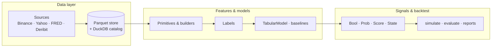

# CryoQuant

**A local Python library for systematic quant research:** load market data, build features, train models, emit typed signals, and backtest — with reproducible parquet storage and no mandatory cloud stack.

CryoQuant is a **library, not a pipeline runner**. You import it from scripts, notebooks, or your own `analyses/` folders. The framework is strict at the seams (symbols, bar schemas, signal contracts, trade logs) and loose in the middle (pandas joins, optional feature builders, analysis-local glue).

```text
data → features → labels → models → signals → backtest
```

Built from crypto-native research (BTC spot, Deribit options, funding, macro overlays) but **asset-agnostic** at the API level — equities, FX, and macro series use the same `Symbol` + `load_track` patterns.

---

## Table of contents

- [Who is this for?](#who-is-this-for)
- [What you can do](#what-you-can-do)
- [Architecture](#architecture)
- [Choose your path](#choose-your-path)
- [Quick start](#quick-start)
- [Entry points](#entry-points)
- [Minimal library example](#minimal-library-example)
- [Data sources](#data-sources)
- [Configuration](#configuration)
- [Project structure](#project-structure)
- [Documentation](#documentation)
- [Testing](#testing)
- [Design principles](#design-principles)
- [Contributing](#contributing)

---

## Who is this for?

| You are… | CryoQuant helps you… |
|---|---|
| **Quant researcher** | Prototype indicators and ML signals locally, with versioned features and walk-forward evaluation |
| **Systematic trader (crypto)** | Backtest BTC spot legs and Deribit option follow-through on shared signal events |
| **ML engineer in markets** | Compose multi-source feature panels, calibrate `ProbSignal`s, and export trade logs |
| **Team building on CryoTrader / CryoBacktester** | Produce typed signal history and read-only options parquets via shared `cryocore` schemas |

You should be comfortable with **Python 3.12**, **pandas**, and basic backtest concepts. You do **not** need a running database server, Kubernetes, or a proprietary data vendor to get started — Binance public REST and local parquet caches are enough for the shipped examples.

---

## What you can do

- **Ingest and cache** OHLCV from Binance spot/perp, Yahoo, Twelve Data; macro from FRED/CBOE; Deribit options chains (read-only via CryoBacktester parquets)
- **Build features** with 40+ tier-1 primitives (`rsi`, `ema`, `supertrend`, …) or versioned tier-2 builders (`TrendFeatures`, `MacroFeatures`, …)
- **Label bars** for supervised learning (forward returns, triple-barrier, regime tags)
- **Train models** — rule baselines, LightGBM + isotonic calibration, purged k-fold / walk-forward CV
- **Emit signals** — `BoolSignal`, `ScoreSignal`, `StateSignal`, `ProbSignal` with a shared protocol
- **Backtest** — vectorised spot simulation, option leg evaluation, HTML reports, sweep leaderboards, robustness stats (deflated Sharpe, bootstrap CI)
- **Align heterogeneous tracks** — `align_series`, `load_track`, `DataPanel` for quick studies and multi-source ML

Offline test suite: **500+ tests** green by default (live/network tests opt-in via pytest markers).

---

## Architecture



**Packages:**

| Package | Role |
|---|---|
| [`cryocore`](cryocore/) | Shared types — `Symbol`, `Instrument`, calendars, UTC time helpers, cross-repo Pydantic schemas |
| [`cryoquant`](cryoquant/) | Pipeline — `data`, `features`, `models`, `signals`, `backtest`, `cli` |

Domain-specific studies (CDX credit, custom fund specs, etc.) live under [`analyses/`](analyses/) and are **not** part of the core library API.

---

## Choose your path

Not every task needs all six layers. Pick the workflow that matches your goal:

| Path | When to use | Example | Key APIs |
|---|---|---|---|
| **A — Quick** | 2–5 series, rule indicator | [`scripts/quick_indicator.py`](scripts/quick_indicator.py) | `load_track`, `align_series`, primitives, `BoolSignal`, `simulate` |
| **B — Study** | Many symbols, parameter sweeps | `analyses/*/run_sweep.py` pattern | `ingest`, `breakout_sim`, `bundle`, `sweep_collector` |
| **C — ML** | 10–20+ heterogeneous tracks | [`scripts/ml_multi_source.py`](scripts/ml_multi_source.py) | `DataPanel`, builders, `walk_forward_fit`, `ProbSignal` |

Full decision guide: [docs/how_to_use.md §2](docs/how_to_use.md#2-choose-your-path).

---

## Quick start

### 1. Install

Requires **Python 3.12+**.

```bash
git clone <your-repo-url> CryoQuant
cd CryoQuant

python3.12 -m venv .venv
source .venv/bin/activate   # Windows: .venv\Scripts\activate

pip install -e ".[dev]"
```

Optional extras: `pip install -e ".[macro]"` (FRED helpers), `pip install -e ".[dashboard]"` (Panel/Bokeh).

### 2. Verify

```bash
python -m pytest tests/ -q
# expect: 500+ passed, live/slow deselected by default
```

### 3. Run Hello World

Daily EMA 7/21 crossover on BTC/USDT — loads Binance data, simulates long/short legs, writes HTML under `reports/`:

```bash
python scripts/ema_cross_backtest.py
```

### 4. Try a quick indicator (Path A)

BTC 1h + VIX macro, RSI/EMA rule, no model registry:

```bash
python scripts/quick_indicator.py
```

> **Network:** spot examples fetch live market data on first run and cache to `data/` (configurable). Re-runs use local parquet.

---

## Entry points

### Example scripts

| Script | What it demonstrates |
|---|---|
| [`scripts/ema_cross_backtest.py`](scripts/ema_cross_backtest.py) | End-to-end spot backtest — features, `BoolSignal`, metrics, HTML report |
| [`scripts/ema_cross_options_backtest.py`](scripts/ema_cross_options_backtest.py) | Same signal events → Deribit call/put evaluation (needs CryoBacktester parquets) |
| [`scripts/quick_indicator.py`](scripts/quick_indicator.py) | Path A — `load_track`, `align_series`, inline primitives |
| [`scripts/ml_multi_source.py`](scripts/ml_multi_source.py) | Path C — `DataPanel`, `walk_forward_fit`, `ProbSignal` (synthetic demo data) |
| [`scripts/e2e_live.py`](scripts/e2e_live.py) | Live integration smoke (opt-in; marked `live` in pytest) |

### CLI

CryoQuant is **library-first**; the CLI exposes catalog/model introspection and compatibility stubs for legacy workflows:

```bash
python -m cryoquant.cli --help

python -m cryoquant.cli catalog list      # datasets in DuckDB catalog
python -m cryoquant.cli models list       # registered model artifacts
python -m cryoquant.cli models inspect <model_id>
```

`backtest` and `signals publish` subcommands remain as **stubs** that print guidance and exit 0 — use `simulate()` and signal publishers directly. See [`cryoquant/cli/__init__.py`](cryoquant/cli/__init__.py).

### Library imports

```python
from cryocore.instruments import Symbol
from cryoquant.data.resolve import load_track
from cryoquant.features.primitives import ema, rsi
from cryoquant.signals.base import BoolSignal
from cryoquant.backtest.spot_pnl import simulate
```

### Analysis folders

For hypothesis-specific work, create `analyses/<your_study>/` with its own scripts, configs, and `reports/` output. Promote reusable code into `cryoquant/` when a second analysis needs the same pattern.

---

## Minimal library example

Rule-based long when RSI is oversold and price is above a short EMA — ~15 lines, no registry:

```python
from datetime import datetime, timedelta, timezone

from cryocore.instruments import Symbol
from cryoquant.backtest.spot_pnl import simulate
from cryoquant.data.resolve import load_track
from cryoquant.features.primitives import ema, rsi
from cryoquant.signals.base import BoolSignal

end = datetime.now(timezone.utc)
start = end - timedelta(days=90)

bars = load_track(Symbol("binance.spot", "BTCUSDT"), "1h", start, end)
bars["rsi14"] = rsi(bars["close"], 14)
bars["ema24"] = ema(bars["close"], 24)

signal = BoolSignal(
    "rsi_ema_long",
    condition=lambda df: (df["rsi14"] < 35) & (df["close"] > df["ema24"]),
)
result = simulate(signal, bars, hold_h=24, fee_bps=5.0)
print(result.metrics)
```

More recipes: [docs/how_to_build_a_study.md](docs/how_to_build_a_study.md).

---

## Data sources

| Source | Asset classes | Notes |
|---|---|---|
| Binance spot / perp | Crypto OHLCV, funding | Public REST; partitioned parquet cache |
| Yahoo / Twelve Data | Equities, indices, FX | Auto-routing for intraday via Twelve Data when configured |
| FRED / CBOE | Macro (VIX, rates, …) | `macro_store` parquet; optional `FRED_API_KEY` |
| Deribit (via CryoBacktester) | Options chains, spot | **Read-only** parquets at `CRYOBACKTESTER_DATA_DIR` |

Unified loader: `load_track(symbol, tf, start, end)` routes OHLCV vs macro based on instrument metadata.

Batch ingestion for many symbols: `cryoquant.data.ingest` + universe YAML — see Path B in the docs.

---

## Configuration

Runtime paths live in [`cryoquant/config.py`](cryoquant/config.py). Override via environment variables or a gitignored `cryoquant/config_local.py`.

| Variable | Default | Purpose |
|---|---|---|
| `CRYOQUANT_STORE_ROOT` | `./data` | Partitioned OHLCV / macro parquet root |
| `CRYOQUANT_CATALOG_DB` | `{STORE_ROOT}/catalog.duckdb` | Dataset + model registry |
| `CRYOBACKTESTER_DATA_DIR` | `~/CryoBacktester/backtester/data` | Deribit options parquets (read-only) |
| `FRED_API_KEY` | — | Optional; public CSV fallback exists |
| `TWELVEDATA_API_KEY` | — | Intraday equity/FX via Twelve Data |

`.env` in the repo root is loaded automatically when `python-dotenv` is installed.

---

## Project structure

```text
CryoQuant/
├── cryocore/           # Shared domain types, calendars, instruments
├── cryoquant/          # Main library
│   ├── data/           # Sources, loader, resolve, ingest, macro_store, catalog
│   ├── features/       # Primitives, builders, align, panel, labels, store
│   ├── models/         # TabularModel, CV, fit_loop, registry
│   ├── signals/        # Signal protocol + publishers
│   ├── backtest/       # simulate, options, reports, sweep infra
│   └── cli/            # catalog / models commands
├── scripts/            # Runnable end-to-end examples
├── analyses/           # Domain-specific studies (not core API)
├── docs/               # User guides (see docs/README.md)
├── tests/              # Offline test suite
├── notebooks/          # Exploratory work
├── reports/            # Generated HTML (gitignored output)
└── reference/          # Read-only research lineage snapshots
```

---

## Documentation

Start at **[docs/README.md](docs/README.md)**.

| Guide | Contents |
|---|---|
| [how_to_use.md](docs/how_to_use.md) | Full walkthrough — setup, paths A/B/C, loading, features, ML, backtest |
| [how_to_build_a_study.md](docs/how_to_build_a_study.md) | Cookbook — new data track → features → signal → backtest |
| [glossary.md](docs/glossary.md) | Terms — `Symbol`, `DatasetRef`, `DataPanel`, paths, etc. |

Internal planning history (phase specs, ADRs) is archived under [docs/archive/](docs/archive/) for contributors.

---

## Testing

```bash
# Default — offline only (~500+ tests, a few seconds)
python -m pytest tests/ -v

# Include slow tests
python -m pytest tests/ -v -m slow

# Live / network tests (Binance, etc.)
python -m pytest tests/ -v -m live
```

Markers and defaults are in [`pyproject.toml`](pyproject.toml). Lint with `ruff check cryoquant cryocore tests`.

---

## Design principles

- **UTC-first** — all bar timestamps are tz-aware; closed-bar safety for features
- **Local-first** — parquet partitions + DuckDB catalog; no required cloud infra
- **Versioned features** — deterministic builder IDs for cache keys and reproducibility
- **Typed seams** — `Signal` protocol, `TRADE_COLUMNS`, Pydantic emit schemas for downstream systems
- **Strict at seams, loose in the middle** — enforce data ingress and backtest egress; compose freely in between

CryoQuant grew out of IndicatorBench / pineforge indicator work and `long_tradable_options` quant research. The [`reference/`](reference/) tree preserves read-only snapshots of that lineage.

---

## Contributing

1. Keep public functions typed and covered by tests for behaviour changes.
2. Prefer deterministic feature and model IDs.
3. Preserve UTC / closed-bar assumptions — no lookahead in feature builders.
4. Put reusable framework code in `cryoquant/`; keep hypothesis-specific economics in `analyses/`.
5. Do not commit secrets — use `.env` or `config_local.py`.

Planning docs and ADRs: [docs/archive/](docs/archive/).

---

## Status

| Area | State |
|---|---|
| Core pipeline (data → backtest) | Shipped |
| Workflow glue (`align`, `resolve`, `panel`, `fit_loop`) | Shipped |
| CLI `catalog` / `models` | Shipped |
| CLI `backtest` / `signals publish` | Compatibility stubs → use library API |
| CryoTrader / CryoBacktester cross-repo wiring | Postponed — read-only parquet bridge only |
