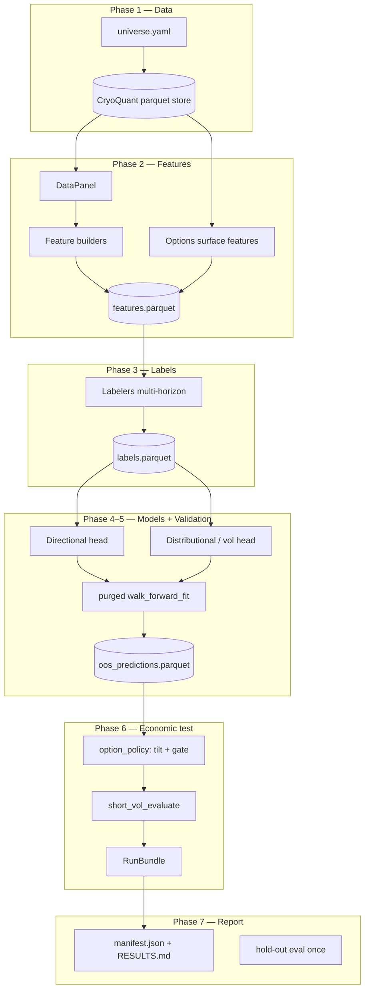

# BTCpredict — Implementation Specification

**Audience:** AI coding agents implementing this study.  
**North star:** [`KICKOFF.md`](KICKOFF.md) — principles (§6), pipeline (§5), decision register (§11), reuse map (§9).  
**Rule:** Reuse CryoQuant APIs where §9 says **Reuse**; extend or build only where specified. Study-specific economics live under `analyses/BTCpredict/`; reusable seams belong in `cryoquant/`.

---

## 0. Agent instructions

1. **Read `KICKOFF.md` §6** before writing code. Principles P-0–P-10, P-0b, P-7b are invariants — encode as tests, not comments.
2. **Implement phases in order.** Phase 0–3 complete (2026-06-28). **Phase 4 (models)** is next per §10.
3. **Never use label columns as features.** Labels are forward-looking targets only.
4. **Fit transforms on train only** (scalers, winsor bounds, calibrators, feature selectors).
5. **Log every hyperparameter / strategy trial** to `trial_log.jsonl` — required for deflated Sharpe (D-12).
6. **Touch the frozen hold-out exactly once** (Phase 7 only).
7. Promote code to `cryoquant/` when a second analysis would reuse it; keep hypothesis-specific glue in `analyses/BTCpredict/src/`.

---

## 1. Locked scope (from KICKOFF §11)

| Item | Value |
|---|---|
| **Goals** | (1) Directional forecast; (2) **Primary** — short-vol option signal |
| **Cadence** | Daily primary; hourly only for intraday feature engineering |
| **Directional assets** | BTC, ETH, SOL (SOL via pool/transfer) |
| **Options book** | BTC + ETH only; SOL options **deferred** |
| **Horizons** | T+1d, T+5d, T+10–21d (map to DTE ~1–2 / 7 / 14–30) |
| **Heads** | Directional (probabilistic) + distributional/exceedance + realized-vol |
| **Option structure** | Model-tilted short strangles; **naked + defined-risk** both built; defined-risk is default |
| **Management** | Parameterize & sweep via `ExitRule` |
| **Data** | Free sources + Deribit surface (no paid on-chain v1) |
| **Models v1** | LightGBM + calibration; quantile-LGBM + GARCH/HAR-RV baselines |
| **Validation** | Purged walk-forward + embargo; permutation test; Phase 2: CPCV/PBO |
| **Objective** | Deflated Sharpe with **hard CVaR cap**; beat naive seller after costs |
| **Use** | Research signal engine (D-17); honest bid/ask; full margin realism Phase 2 |

**Open parameters (defaults in `config.yaml`; sweep, do not hard-code):**

| Parameter | Default | Notes |
|---|---|---|
| `risk.cvar_alpha` | `0.05` | 5% CVaR |
| `risk.max_cvar_loss_pct` | `0.15` | Reject configs with OOS CVaR worse than −15% per trade |
| `options.target_delta` | `[0.10, 0.15, 0.20]` | Sweep grid |
| `options.wing_delta_offset` | `[0.05, 0.10]` | For defined-risk long wing |
| `validation.embargo_bars` | `21` | ≈ longest horizon (1–3 weeks daily) |
| `splits.holdout_start` | `2024-06-01` | **Frozen at Phase 0**; adjust only with principal approval |

---

## 2. Architecture



**Dependency direction:** `cryocore` ← `cryoquant` ← `analyses/BTCpredict/src` ← `run_phase*.py`.

---

## 3. Repository layout

### 3.1 Study folder (`analyses/BTCpredict/`)

```text
analyses/BTCpredict/
├── SPEC.md                 # this file
├── KICKOFF.md
├── config.yaml             # study parameters (frozen hold-out, grids, risk caps)
├── universe.yaml           # data universe manifest (versioned)
├── .gitignore
├── run_phase0_config.py    # validate config, write split manifest
├── FEATURE_CATALOG.md      # Phase 2 feature register (signed off 2026-06-28)
├── LABEL_CATALOG.md        # Phase 3 label register (signed off 2026-06-28)
├── features.yaml           # machine-readable catalog (core / extended tags)
├── labels.yaml             # machine-readable label families 1–6
├── run_phase1_ingest.py
├── run_phase1_qa.py        # Phase 1.5 data QA gate (before features)
├── run_phase2_features.py
├── run_phase2_qa.py        # Phase 2 QA gate (after features)
├── run_phase3_labels.py
├── run_phase3_qa.py        # Phase 3 QA gate (after labels)
├── run_phase4_train.py
├── run_phase5_validate.py
├── run_phase6_backtest.py
├── run_phase7_report.py
├── src/
│   ├── __init__.py
│   ├── paths.py            # ANALYSIS_ROOT, data/reports dirs
│   ├── config_models.py    # Pydantic wrappers for config.yaml
│   ├── panel_build.py      # assemble feature panel (Phase 2)
│   ├── label_build.py      # assemble label store (Phase 3)
│   ├── feature_align.py    # available_utc + FOMC calendar alignment
│   ├── feature_schema.py   # features.yaml → column registry / finalize_panel
│   ├── phase2_qa.py        # Phase 2 QA checks
│   ├── phase3_qa.py        # Phase 3 QA checks
│   ├── signal_compose.py   # merge directional + vol heads → gates/tilts
│   ├── option_policy.py    # model-tilted strangle policy (D-13)
│   └── trial_log.py        # append-only trial counter for DSR
├── tests/
│   ├── conftest.py
│   ├── test_config.py
│   ├── test_phase1_*.py
│   └── ...
├── data/                   # gitignored — study artifacts
│   ├── splits.json         # frozen train/dev/hold-out boundaries
│   ├── panel.parquet
│   ├── features.parquet
│   ├── features_schema.json
│   ├── phase2_qa_report.json
│   ├── labels.parquet
│   ├── labels_schema.json
│   ├── phase3_qa_report.json
│   └── trial_log.jsonl
└── reports/                # gitignored — bundles, HTML, RESULTS.md
```

### 3.2 CryoQuant extensions (promote here)

| Module | Additions |
|---|---|
| `cryocore/instruments.py` | Register `binance.spot:SOLUSDT` |
| `cryoquant/data/sources/` | `fear_greed.py`, `defillama.py`, `farside_etf.py`, `strategy_treasury.py`, `coinmetrics.py`, `deribit_indices.py`, `fomc_calendar.py`, `xoomar_oi.py`; wire `binance_perp.fetch_funding` |
| `cryoquant/features/labels.py` | `LogReturnLabeler`, `RealizedVolLabeler`, `ExceedanceLabeler`, `MultiHorizonSpec` |
| `cryoquant/features/crypto_builders.py` | `CryptoFeatures` tier-2 builder (on-chain + sentiment) |
| `cryoquant/models/baselines.py` | `NaiveRandomWalk`, `RollingMeanPredictor`, `RidgePredictor` |
| `cryoquant/models/tabular.py` | `TabularRegressor`, `QuantileModel` (LGBM quantile objectives) |
| `cryoquant/models/fit_loop.py` | `embargo_bars` wired; optional `use_purged_kfold` |
| `cryoquant/models/validation.py` | **new** — `permutation_test`, `leakage_audit` |
| `cryoquant/backtest/short_vol.py` | **new** — `ShortVolConfig`, `evaluate_short_vol` (sell side + spread) |
| `cryoquant/backtest/short_vol_metrics.py` | **new** — OTM-rate vs δ, CVaR, physical-vs-implied overlay |
| `tests/` | Mirror each extension with unit + methodology tests |

---

## 4. Data models

All study config is validated via Pydantic v2 (`extra="forbid"`). Agents must not read raw YAML dicts in business logic — use these models.

### 4.1 Core identifiers

```python
# cryoquant or analyses/BTCpredict/src/config_models.py

from datetime import date
from enum import Enum
from pydantic import BaseModel, ConfigDict, Field
from cryocore.instruments import Symbol

class HorizonId(str, Enum):
    H1 = "T+1d"      # horizon_bars=1 on daily
    H5 = "T+5d"      # horizon_bars=5
    H21 = "T+10-21d" # horizon_bars=14 default (configurable 10–21)

class AssetId(str, Enum):
    BTC = "BTC"
    ETH = "ETH"
    SOL = "SOL"

class ModelHeadId(str, Enum):
    DIRECTIONAL = "directional"
    DISTRIBUTIONAL = "distributional"
    REALIZED_VOL = "realized_vol"
    LOG_RETURN_BENCH = "log_return_bench"

class OptionStructure(str, Enum):
    NAKED = "naked"
    CREDIT_SPREAD = "credit_spread"   # short leg + long wing
    STRANGLE = "strangle"
```

### 4.2 Configuration records

```python
class HorizonSpec(BaseModel):
    model_config = ConfigDict(frozen=True)
    id: HorizonId
    horizon_bars: int = Field(ge=1)
    dte_targets: list[int] = Field(min_length=1)  # e.g. [1,2], [7], [14,21,30]

class SplitManifest(BaseModel):
    """Written once in Phase 0; immutable thereafter."""
    model_config = ConfigDict(frozen=True)
    holdout_start: date
    dev_end: date          # == holdout_start - 1 day
    dev_start: date        # per-asset or global
    bar_cadence: str = "1d"
    notes: str = ""

class WalkForwardSpec(BaseModel):
    train_window_bars: int = 750    # ~3y daily
    test_window_bars: int = 90
    step_bars: int = 90
    embargo_bars: int = 21

class RiskSpec(BaseModel):
    cvar_alpha: float = 0.05
    max_cvar_loss_pct: float = 0.15   # promotion gate (D-12)
    deflated_sharpe_min: float = 0.0
    pbo_max: float = 0.25             # Phase 2 when CPCV exists

class OptionBookSpec(BaseModel):
    venue: str = "deribit"
    underlyings: list[AssetId] = [AssetId.BTC, AssetId.ETH]
    target_deltas: list[float] = [0.10, 0.15, 0.20]
    wing_delta_offsets: list[float] = [0.05, 0.10]
    structures: list[OptionStructure] = [OptionStructure.STRANGLE, OptionStructure.CREDIT_SPREAD]
    default_structure: OptionStructure = OptionStructure.CREDIT_SPREAD  # D-16
    tilt_threshold: float = 0.55        # directional prob to lean one side
    min_physical_edge: float = 0.02     # physical P(OTM) - (1-delta) minimum to fire

class LabelSpec(BaseModel):
    direction_threshold_pct: float       # vol-scaled override in builder
    use_vol_scaled_threshold: bool = True
    exceedance_deltas: list[float] = [0.10, 0.15, 0.20]
    realized_vol_window: int = 5         # bars for H-day RV label

class StudyConfig(BaseModel):
    horizons: list[HorizonSpec]
    splits: SplitManifest
    walk_forward: WalkForwardSpec
    risk: RiskSpec
    option_book: OptionBookSpec
    label: LabelSpec
    feature_budget_max: int = 100
    random_seed: int = 42
```

### 4.3 Runtime artifacts (parquet schemas)

**`panel.parquet` / `features.parquet`** — one row per `(timestamp, asset)` or per `timestamp` with asset-prefixed columns:

| Column group | Examples | Rules |
|---|---|---|
| Keys | `timestamp` (UTC), `asset` | Primary index |
| OHLCV | `close`, `high`, `low`, `open`, `volume` | From `load_track` |
| Features | `ret_1d`, `rsi_14`, `iv_minus_rv`, … | Causal only; no future data |
| Meta | `feature_builder_id`, `feature_builder_version` | Provenance |

**`labels.parquet`** — long format preferred for multi-horizon:

| Column | Type | Description |
|---|---|---|
| `timestamp` | datetime64[UTC] | Bar open |
| `asset` | str | BTC/ETH/SOL |
| `horizon_id` | str | T+1d / T+5d / T+10-21d |
| `label_name` | str | e.g. `up_win_t1p5_h1`, `exceedance_call_d0p15_h5`, `rv_5d` |
| `value` | float/bool | Target; NaN where forward window incomplete |

**`oos_predictions.parquet`**

| Column | Description |
|---|---|
| `timestamp`, `asset`, `horizon_id`, `head` | Keys |
| `y_true`, `y_prob`, `y_pred_quantiles` | OOS only |
| `fold_id`, `model_id` | Traceability |

**`trial_log.jsonl`** — one JSON object per config tried:

```json
{"trial_id": 1, "phase": "phase6", "params": {"delta": 0.15, "dte": 7}, "metric": {"sharpe": 0.4, "cvar": -0.08}}
```

### 4.4 Option backtest result (`ShortVolResult`)

Extend/replace buyer-centric `OptionResult`:

```python
class ShortVolResult(BaseModel):
    model_config = ConfigDict(frozen=True)
    fires_evaluated: int
    fires_with_data: int
    pnl_pct: list[float]
    win_rate: float
    expectancy: float
    cvar: float                    # CVaR at risk.cvar_alpha
    max_loss_pct: float
    otm_rate: float                # realized terminal OTM fraction
    implied_otm_rate: float        # mean(1 - delta) at entry
    calibration_gap: float         # otm_rate - (1 - mean_delta) — should be > 0 for edge
    entry_credits_usd: list[float]
    structure: OptionStructure
```

---

## 5. Data universe — **approved** (signed off 2026-06-28)

> **Authoritative register:** [`DATA_SOURCES.md`](DATA_SOURCES.md) (signed off 2026-06-28).  
> **Machine manifest:** [`universe.yaml`](universe.yaml) — generated from approved `include` rows.  
> Phase 1 ingest **complete** 2026-06-28 (`config.yaml`: `phase1_complete: true`; manifest frozen).

**Locked (KICKOFF D-3):** free public sources + Deribit options surface (DVOL + forward chains); no paid on-chain v1.

### 5.1 Approved universe summary

| Block | IDs | Notes |
|---|---|---|
| **OHLCV** | A1–A6 | Binance spot canonical; daily + hourly (2020+ for 1h) |
| **Perp** | B1–B5 | Funding BTC/ETH/SOL + OI BTC/ETH via **Xoomar** (~2021+ daily) |
| **Options** | C1–C5 | DVOL + local chains (~Apr 2025+) + forward ingest; see [`OPTIONS_SURFACE_PROXY_PROPOSAL.md`](OPTIONS_SURFACE_PROXY_PROPOSAL.md) |
| **Macro** | D1–D6, D14 | FRED/Yahoo/CBOE minimal pack + **FOMC decision-day calendar** |
| **Institutional** | E1–E2, E4–E5 | Farside ETF flows + Strategy.com MSTR treasury (§E.1 alignment) |
| **Crypto-alt** | F1–F2 | Fear & Greed + stablecoin supply (F3–F5 deferred) |
| **Network** | G1–G4 | Coin Metrics Community (§G.3 alignment) |
| **Derived** | H1–H7 | Ratios, RV, VRP, flow/network momentum — ✅ in `features.parquet` (Phase 2 complete 2026-06-28) |

**Goal 2 chain backtest window:** Deribit option chains exist only from **~Apr 2025** (hold-out). Dev-era Goal 2 validation uses **DVOL + exceedance metrics**, not chain P&L. Phase 7 is the first chain-accurate short-vol backtest.

Full manifest: [`universe.yaml`](universe.yaml).

---

## 6. Phase 0 — Scaffold & frozen splits

**Goal:** Create study tree, validate config, **freeze hold-out boundary** before any modeling.

### 6.1 Deliverables

- [x] Directory tree per §3.1
- [x] `config.yaml` (`data_sources_reviewed: true`, `phase1_complete: true`, signed off 2026-06-28)
- [x] **[`DATA_SOURCES.md`](DATA_SOURCES.md)** reviewed by principal — per-source include/exclude
- [x] `universe.yaml` generated from approved DATA_SOURCES rows
- [x] `src/paths.py`, `src/config_models.py` with `load_study_config() -> StudyConfig`
- [x] `run_phase0_config.py` writes `data/splits.json` from `SplitManifest`
- [x] `tests/test_config.py`

### 6.2 `config.yaml` skeleton

```yaml
study_id: btcpredict_v1
random_seed: 42

splits:
  holdout_start: "2024-06-01"
  dev_start: "2018-01-01"

horizons:
  - id: T+1d
    horizon_bars: 1
    dte_targets: [1, 2]
  - id: T+5d
    horizon_bars: 5
    dte_targets: [7]
  - id: T+10-21d
    horizon_bars: 14
    dte_targets: [14, 21, 30]

walk_forward:
  train_window_bars: 750
  test_window_bars: 90
  step_bars: 90
  embargo_bars: 21

risk:
  cvar_alpha: 0.05
  max_cvar_loss_pct: 0.15

option_book:
  underlyings: [BTC, ETH]
  target_deltas: [0.10, 0.15, 0.20]
  default_structure: credit_spread
  tilt_threshold: 0.55
```

### 6.3 Tests — Phase 0

| ID | Test | Type |
|---|---|---|
| P0-T01 | `load_study_config()` parses YAML into `StudyConfig`; unknown keys rejected | unit |
| P0-T02 | `holdout_start` < today and > `dev_start` | unit |
| P0-T03 | `run_phase0_config.py` writes `data/splits.json`; second run byte-identical (idempotent) | unit |
| P0-T04 | `SplitManifest` immutability — attempt to mutate raises | unit |
| P0-T05 | All `HorizonSpec.dte_targets` non-empty; `horizon_bars` matches KICKOFF mapping | unit |

---

## 7. Phase 1 — Data ingest & catalog

**Status:** ✅ **Complete 2026-06-28** (`config.yaml`: `phase1_complete: true`; manifest: 33 series ok, 2 skipped, E3 deferred).

**Goal:** Immutable raw data in CryoQuant store for the **approved** universe; Deribit DVOL + chains reachable; provenance registered.

**Prerequisite:** `DATA_SOURCES.md` sign-off (§J checklist) and `data_sources_reviewed: true`. ✅ Met 2026-06-28.

### 7.1 Work items

**Reuse:** `cryoquant.data.ingest.run_ingest`, `load_track`, `macro_store`, `catalog`, `deribit_options.load_chain`, `binance_perp.fetch_funding`.

**Extend/build:**

1. ✅ Register `SOLUSDT` in `cryocore/instruments.py`.
2. ✅ Wire `binance.perp` funding (B1, B2, B5) → macro-like daily series via ingest router.
3. ✅ Add `cryoquant/data/sources/xoomar_oi.py` (B3, B4) — Xoomar Pulse daily OI from 2021-01 (see DATA_SOURCES §B.1). Binance OI endpoint rejected (~30d only).
4. ✅ Add `cryoquant/data/sources/fear_greed.py` (F1) — daily index → `macro_store`.
5. ✅ Add `cryoquant/data/sources/defillama.py` (F2) — stablecoin supply only (not TVL).
6. ✅ Add `cryoquant/data/sources/farside_etf.py` (E1–E2) + `strategy_treasury.py` (E4–E5). SoSoValue excluded (30d ETF API cap). §E.1 alignment via shared `available_utc` helpers.
7. ✅ Add `cryoquant/data/sources/coinmetrics.py` (G1–G4) — Community API with chain-date lag (§G.3).
8. ✅ Add `cryoquant/data/sources/deribit_indices.py` (C1–C2) — DVOL via `get_volatility_index_data` (paginated).
9. ✅ Add `cryoquant/data/sources/fomc_calendar.py` (D14) — Fed published calendar → `is_fomc_decision_day` (§D.3).
10. ✅ Forward Deribit chain snapshot ingest (C5) + verify local parquets (C3–C4).
11. ✅ `run_phase1_ingest.py` + `src/ingest.py` study router — writes `data/ingest_manifest.json` (row counts, date ranges per series).

### 7.2 API contracts

```python
# cryoquant/data/sources/fear_greed.py
def fetch_series(start: date, end: date) -> pd.DataFrame:
    """Columns: timestamp (UTC index), value (0–100)."""

# cryoquant/data/sources/defillama.py
def fetch_stablecoin_supply(start: date, end: date) -> pd.DataFrame: ...

# cryoquant/data/sources/farside_etf.py
def fetch_aggregate_flows(start: date, end: date) -> pd.DataFrame: ...
def fetch_all_ticker_flows(tickers: list[str], start: date, end: date) -> dict[str, pd.DataFrame]: ...

# cryoquant/data/sources/strategy_treasury.py
def fetch_mstr_purchases(start: date, end: date) -> pd.DataFrame: ...
def fetch_mstr_holdings(start: date, end: date) -> pd.DataFrame: ...

# cryoquant/data/sources/coinmetrics.py
def fetch_asset_metric(asset: str, metric: str, start: date, end: date) -> pd.DataFrame: ...

# cryoquant/data/sources/deribit_indices.py
def fetch_dvol(underlying: str, start: date, end: date) -> pd.DataFrame: ...

# cryoquant/data/sources/fomc_calendar.py
def fetch_fomc_decision_days(start: date, end: date) -> pd.DataFrame:
    """Columns: decision_date, available_utc, is_fomc_decision_day."""

# cryoquant/data/sources/xoomar_oi.py
def fetch_open_interest(asset: str, start: date, end: date) -> pd.DataFrame:
    """Columns: open_interest, open_interest_usd, long_short_ratio (optional)."""
```

### 7.3 Data quality gates (hard fail ingest if violated)

- All OHLCV timestamps tz-aware UTC.
- No duplicate `(symbol, tf, timestamp)` rows post-clean.
- Macro merged backward-only; document max staleness per series.
- Institutional (E*) and network (G*) series carry `available_utc`; features use backward `merge_asof` only.
- FOMC flags (D14): `is_fomc_decision_day` not visible before `available_utc` (§D.3).
- **Deribit DVOL:** BTC from 2021-03-31, ETH from ~2022-01 — required for Goal 2 dev features.
- **Deribit chains:** verify local parquets from ~2025-04-01 onward for BTC/ETH; forward ingest active. **Do not** require ≥252 chain files on dev (chains are hold-out-era only; see OPTIONS proposal).

### 7.4 Tests — Phase 1

| ID | Test | Type |
|---|---|---|
| P1-T01 | `fetch_series` fear/greed returns monotonic UTC index, values in [0,100] | unit (mock HTTP) |
| P1-T02 | DefiLlama stablecoin fetch parses JSON; handles empty response | unit (mock) |
| P1-T03 | `SOLUSDT` registered; `Symbol.parse("binance.spot:SOLUSDT")` loads | unit |
| P1-T04 | Ingest manifest: BTC daily rows ≥ 1000; dates continuous modulo exchange gaps | integration |
| P1-T05 | **Lookahead:** macro at date *t* equals last observation with `release_date ≤ t` (synthetic macro with known release lag) | methodology |
| P1-T06 | Re-ingest idempotency: second ingest same range → identical parquet hash | integration |
| P1-T07 | Funding series aligns to daily index without same-day future leak | unit |
| P1-T08a | ETF flow for `trade_date=Fri` not present on BTC bar before §E.1 `available_utc` | methodology |
| P1-T08b | MSTR `btc_acq` not on bar before `available_utc` | methodology |
| P1-T08c | Coin Metrics metric at *t* uses chain_date ≤ *t*−1 (§G.3) | methodology |
| P1-T09 | FOMC flag not set before decision-day `available_utc` (§D.3) | methodology |
| P1-T10 | DVOL series monotonic UTC index; BTC start ≥ 2021-03-31 | integration |
| P1-T11 | Open interest ingest succeeds; documents actual history depth | integration |
| P1-L01 | **Live:** `load_track(BTCUSDT, 1d, 90d)` returns rows; cache hit on repeat | live |
| P1-L02 | **Live:** ingest one month BTC+ETH+SOL daily; catalog lists datasets | live |

### 7.5 Deliverables (frozen 2026-06-28)

| Artifact | Location | Notes |
|---|---|---|
| Ingest manifest | `data/ingest_manifest.json` | 33 ok · H1/H2 skipped · E3 deferred |
| QA report | `data/phase1_qa_report.json`, `reports/phase1_qa_report.txt` | 0 errors · 12 warnings (2026-06-28) |
| Connectors | `cryoquant/data/sources/*.py` | fear_greed, defillama, farside_etf, strategy_treasury, coinmetrics, deribit_indices, fomc_calendar, xoomar_oi |
| Study router | `src/ingest.py`, `run_phase1_ingest.py`, `run_phase1_qa.py` | List-based `universe.yaml` format |
| Tests | `tests/test_phase1_ingest.py`, `tests/test_config.py` | 25 unit tests (mocked HTTP) |
| Raw store | CryoQuant parquet / macro_store | See manifest `ts_min`/`ts_max` per series |

**Key coverage (manifest-verified):**

| Series | Coverage | Caveat |
|---|---|---|
| A1–A6 OHLCV | 2018+ daily; 2020+ hourly | SOL from listing ~2020-08 |
| B1/B2/B5 funding | 2020+ / 2022+ | macro_store |
| B3/B4 OI (Xoomar) | BTC 2021-01-02→; ETH 2021-12-01→ | Pre-2021 NaN; use funding |
| C1 BTC DVOL | 2021-03-31→ (~1916 rows) | Paginated Deribit API |
| C3/C4 chains | ~25 local parquets + forward | Hold-out-era backtest only |
| D1–D6, D14 macro | 2010+/2018+ | FRED/CBOE/Yahoo/FOMC |
| E1–E2 ETF flows (Farside) | 2024-01-11→ (~632 td) | 12 tickers incl. `BTC`; dev ~102 td pre-holdout |
| E4–E5 MSTR (Strategy.com) | 2020-08-10→ (114 events) | Full dev coverage |
| F1/F2, G1–G4 | 2018+ | |

**Maintenance:** run `run_phase1_ingest.py` periodically for forward collection (Xoomar OI, Deribit chains, Farside ETF).

### 7.6 Phase 1 QA (run before Phase 2)

```bash
.venv/bin/python analyses/BTCpredict/run_phase1_qa.py
```

**Checks:** first/last rows · partition month/year edges · UTC timezone · duplicate timestamps · manifest vs disk · OHLCV `audit_bars` · ETF Total vs Σtickers · MSTR monotonicity · `available_utc` lag (no leak).

**Outputs:** `data/phase1_qa_report.json`, `reports/phase1_qa_report.txt`. Exit 1 on errors; warnings allowed.

---

## 8. Phase 2 — Feature engineering

**Status:** ✅ **Complete 2026-06-28** (`config.yaml`: `phase2_complete: true`; QA 0 errors).

**Authoritative feature register:** [`FEATURE_CATALOG.md`](FEATURE_CATALOG.md) + [`features.yaml`](features.yaml).  
Signed off: `config.yaml` → `phase2_catalog_reviewed: true` (2026-06-28). Do not add columns in code that are not listed in the catalog.

**Goal:** Causal daily feature matrix per asset with options-surface columns for BTC/ETH.

**Delivered panel (2026-06-28 build; amended Layer F same day):** `data/features.parquet` — **8,347 rows** (long `(timestamp, asset)`), **162 columns** (159 catalog features + `timestamp` / `asset` / `options_source`).

**Layer F amendment (2026-06-28):** Added `{a}_dvol_rank_252` (core), `{a}_dvol_rank_90` + `{a}_dvol_chg_7d` (extended); demoted `{a}_vol_of_vol` to extended. Implemented in `dvol_features()` — rolling percentile rank on DVOL (0–1, same convention as `rv_rank`).

### 8.1 Work plan (scoped to ingested data)

**Prerequisites (Phase 1):** 33 series ingested · QA pass · dev/hold-out splits frozen · chains from **2025-04-11** (hold-out only) · DVOL from 2021+ · ETF ~102 dev days.

| Step | Deliverable | Status |
|:---:|---|:---:|
| **2.0** | [`FEATURE_CATALOG.md`](FEATURE_CATALOG.md) + [`features.yaml`](features.yaml) — column register, lag rules, **core** (~62) / **extended** (~72) tags | ✅ **Done** 2026-06-28 |
| **2.1** | `analyses/BTCpredict/src/panel_build.py` — load A1–A6; align macro D*, E*, F*, G*, B*, D14 via `align_series` + `available_utc`; primary index = BTC daily | ✅ **Done** 2026-06-28 |
| **2.2** | `cryoquant/features/crypto_builders.py` — `CryptoFeatures` + `NetworkFeatures`: funding, OI, F1/F2, E* (§E.1), **FOMC calendar** (no announcement lag), network momentum (§G.3) | ✅ **Done** 2026-06-28 |
| **2.3** | Wire `TrendFeatures` + adapted `MacroFeatures` / cross-asset globals + `dvol_features()` in `options.py` (DVOL → `iv_minus_rv`, `dvol_rank_*`, `dvol_chg_7d`, `vol_of_vol`) | ✅ **Done** 2026-06-28 |
| **2.4** | Chain features via `deribit_options.load_chain()` — `atm_iv`, `term_slope`, `risk_reversal_25d` **only ≥ 2025-04-11**; NaN on dev by design | ✅ **Done** 2026-06-28 |
| **2.5** | `run_phase2_features.py` → `data/features.parquet` + `data/features_schema.json` (tags from `features.yaml`) | ✅ **Done** 2026-06-28 |
| **2.6** | `run_phase2_qa.py` — warmup NaN audit, finiteness, P2-T02/T03 lookahead (FOMC calendar exempt), manifest vs schema | ✅ **Done** 2026-06-28 (0 errors, 0 warnings) |
| **2.7** | `tests/test_phase2_features.py` — P2-T01–T07 (+ optional P2-L01 live) | ✅ **Done** 2026-06-28 (39 passed, live deselected) |

**Execution order:** 2.1 → 2.2 + 2.3 (can parallel) → 2.4 → 2.5 → 2.6 → 2.7. Run `pytest analyses/BTCpredict/tests/` after each step.

**Explicitly deferred (out of v1 scope):**

- tsfresh / featuretools auto-generation  
- Hourly bars as **modeling** cadence (1h → daily HTF features only, mostly **extended** tier)  
- CPI / HY spread / expanded macro D7–D13  
- E3 ETF AUM  
- Chain features on **dev** period (no backfill; train on DVOL only)  
- SOL options / SOL DVOL  
- Phase 4 feature **selection** (prune raw ~137 → ≤100) — not Phase 2  

**Reuse (CryoQuant):** `DataPanel`, `TrendFeatures`, `MacroFeatures`, `CrossAssetFeatures`, `features/options.py`, `align_series`, `@cached` feature store.

**Key contracts:**

```python
# analyses/BTCpredict/src/panel_build.py
def build_study_panel(cfg: StudyConfig, end: datetime) -> pd.DataFrame:
    """Wide panel: one row per (timestamp, asset). Columns per FEATURE_CATALOG."""

# cryoquant/features/crypto_builders.py
class CryptoFeatures: ...   # funding, sentiment, institutional, FOMC calendar
class NetworkFeatures: ...    # G1–G4 momentum (BTC-only values)
```

**Phase 2 complete when:** steps 2.1–2.7 green · `features.parquet` + `features_schema.json` on disk · `run_phase2_qa.py` exit 0 (warnings OK) · `phase2_complete: true` in `config.yaml`. ✅ **Met 2026-06-28.**

### 8.4 Implementation notes (2026-06-28)

Issues encountered during build and how they were resolved:

| Topic | Note |
|---|---|
| **Datetime index units** | OHLCV (ms), macro/event frames (µs), and `merge_asof` required unified UTC **nanosecond** indices. Fixed in `panel_build._normalize_index()` and `feature_align.align_by_available_utc()`. |
| **Macro load paths** | VIX ingested as `cboe/VIX_CLOSE` but `MacroFeatures` expects ticker `VIX`; DXY stored as `fred/DXY` but builder expects `DX-Y.NYB` — mapped in `panel_build._build_macro_block()`. SPY/GLD loaded via `load_track()` (Yahoo OHLCV), not `macro_store`. |
| **TrendFeatures extras** | `TrendFeatures` emits Group A rule-ready columns (e.g. `ema_20`) not in the catalog. `feature_schema.finalize_panel()` drops extras and NaN-fills catalog-only columns (e.g. SOL options/OI, ETH chain). |
| **Deribit chain schema** | On-disk parquets use `is_call` (not `option_type`) and `%d%b%y` expiry strings. Extended `cryoquant/features/options.py` (`_normalize_chain_df`, single-pass `build_chain_feature_frame`). |
| **Chain performance** | ~439 daily parquets × ~225k rows each; initial triple-pass IV compute + duplicate loads took >5 min. Optimized to **one load per date**, single-pass feature extraction (~**2.4 min** full rebuild). |
| **BTC-only chains** | CryoBacktester `options_*.parquet` files on disk are **BTC underlying only** (underlying ~\$83k). Chain features populate **`btc_*` columns only**; `eth_atm_iv_30d` / `eth_term_slope` / `eth_risk_reversal_25d` remain **NaN** until ETH chain parquets exist (catalog columns still present). |
| **Cross-asset RS** | `rs_vs_spy_*` uses **BTC vs SPY** on all asset rows (Layer B global scope per catalog), not per-asset RS. |
| **Missing SOL history** | SOL listing after `dev_start`; `_load_ohlcv` returns empty frame before SOL exists — panel skips dates without asset bars. |
| **Column count** | `features.yaml` expands `{a}` placeholders → **160 catalog names** (incl. `options_source` meta); tier summary ~137 counts logical feature families before expansion. |
| **Manual validation** | `btc_rsi_14` + `btc_dvol_30d` spot-checked 2026-06-01 vs TradingView/Deribit (2026-06-28). |

**CryoQuant modules touched:** `cryoquant/features/crypto_builders.py` (new), `cryoquant/features/options.py` (`dvol_features`, chain helpers).

**Re-run:** `.venv/bin/python analyses/BTCpredict/run_phase2_features.py` then `run_phase2_qa.py`.

### 8.2 Feature rules (enforce in code review + tests)

See also **FEATURE_CATALOG.md** §Conventions (lag rules, core vs extended tiers).

- No column name prefix `label_`, `fwd_`, `target_` in features.
- Rolling windows use `.shift(1)` where same-bar close would leak (document per feature).
- Options IV features at *t* use chain snapshot ≤ *t* only — **never** expiry-window surface.
- Feature count ≤ `cfg.feature_budget_max` after selection phase (Phase 4).

### 8.3 Tests — Phase 2

| ID | Test | Type |
|---|---|---|
| P2-T01 | `CryptoFeatures.build` output index ⊆ primary index | unit |
| P2-T02 | **Lookahead:** shift feature timestamp +1 day → values change (proves not using future bar) | methodology |
| P2-T03 | **Lookahead:** `atm_iv` at *t* unchanged if chain at *t+1* is modified (entry-time only) | methodology |
| P2-T04 | HTF/intraday align: 1h-derived daily RV uses only hours ≤ daily close | unit |
| P2-T05 | Joined panel has no duplicate columns; all numeric features finite after warmup | integration |
| P2-T06 | Feature builder cache: same inputs → same parquet hash (`@cached`) | unit |
| P2-T07 | Missing macro → NaN or stale per `align_series` cap, not forward-filled from future | unit |
| P2-L01 | **Live:** `build_study_panel` for 6 months BTC; ≥ 30 feature columns | live |

**Manual validation (2026-06-28):** `btc_rsi_14` (Binance UTC daily, lag T−1) and `btc_dvol_30d`
(same-date Deribit index) spot-checked on 2026-06-01 — confirmed.

---

## 9. Phase 3 — Labels

**Status:** ✅ **Complete** — families 1–6 signed off 2026-06-28; family 7 (path/touch) deferred Phase 6.  
**Catalog:** [`LABEL_CATALOG.md`](LABEL_CATALOG.md) · [`labels.yaml`](labels.yaml)

**Goal:** Multi-horizon, multi-head labels in long format — never merged into features.

### 9.0 Locked label register (2026-06-28)

| # | Family | Assets | Horizons |
|---|---|---|---|
| 1 | Directional up / down / magnitude (vol-scaled τ) | BTC, ETH, SOL | T+1d, T+5d, T+10-21d |
| 2 | Log return | BTC, ETH, SOL | all |
| 3 | Forward realized vol | BTC, ETH, SOL | all |
| 4 | Terminal exceedance — call (δ grid) | BTC, ETH | all |
| 5 | Terminal exceedance — put (δ grid) | BTC, ETH | all |
| 6 | VRP realization (`DVOL_t − fwd_RV`) | BTC, ETH | all |
| 7 | Path / touch exceedance | — | **Deferred** (Phase 6 `ExitRule`) |

### 9.1 Work items

**Reuse:** `ForwardReturnLabeler` (directional).

**Extend `cryoquant/features/labels.py`:**

```python
class LogReturnLabeler:
    """y = ln(close[t+H]/close[t])."""
    def __init__(self, horizon_bars: int): ...

class RealizedVolLabeler:
    """y = std(log returns over (t+1..t+H]) annualized."""
    def __init__(self, horizon_bars: int): ...

class ExceedanceLabeler:
    """Terminal exceedance for call/put at strike implied by delta proxy or log-return threshold."""
    def __init__(self, horizon_bars: int, side: Literal["call","put"], threshold_log_return: float): ...
    # y = 1 if terminal close beyond strike (European settlement)

class VRPRealizationLabeler:
    """y = IV_t - RV_realized over (t+1..t+H] (annualised %)."""
    def __init__(self, horizon_bars: int): ...

class VolScaledThreshold:
    """threshold_pct = k * rolling_realized_vol * sqrt(H)."""
    @staticmethod
    def apply(close: pd.Series, horizon_bars: int, k: float = 1.0) -> pd.Series: ...
```

`run_phase3_labels.py`:
- For each `(asset, horizon)` emit directional labels (up/down/magnitude with vol-scaled threshold).
- Emit `LogReturnLabeler`, `RealizedVolLabeler`, `ExceedanceLabeler` (δ = 0.10, 0.15, 0.20; causal rolling quantile strike proxy).
- Emit `VRPRealizationLabeler` for BTC/ETH (`vrp_enabled` in config).
- Write `data/labels.parquet` + `data/labels_schema.json`.
- **Assert:** last `horizon_bars` rows per series are NaN.
- **Defer:** path/touch exceedance (family 7) until Phase 6.

### 9.2 Tests — Phase 3

| ID | Test | Type |
|---|---|---|
| P3-T01 | `ForwardReturnLabeler` last H rows NaN; label at *t* uses only `high/low/close[t+1..t+H]` | unit |
| P3-T02 | **Leakage:** manually set `close[t+1..t+H]` to extreme → label at *t* reacts; change `close[t-1]` → label at *t* unchanged | methodology |
| P3-T03 | `LogReturnLabeler` at *t* equals log(close[t+H]/close[t]) | unit |
| P3-T04 | `ExceedanceLabeler` call: y=1 iff close[t+H] > strike derived from threshold | unit |
| P3-T05 | Vol-scaled threshold increases when trailing vol increases | unit |
| P3-T06 | Long-format labels: unique key `(timestamp, asset, horizon_id, label_name)` | integration |
| P3-T07 | Label columns never appear if `build_study_features()` called with `include_labels=False` | unit |

### 9.3 Phase 3 checklist

| Step | Deliverable | Status |
|---|---|---|
| **3.0** | Label register signed off — [`LABEL_CATALOG.md`](LABEL_CATALOG.md) families 1–6; family 7 deferred | ✅ **2026-06-28** |
| **3.1** | Extend `cryoquant/features/labels.py` — log return, fwd RV, exceedance, VRP, vol-scaled τ | ✅ |
| **3.2** | `src/label_build.py` + `run_phase3_labels.py` — long-format melt from OHLCV + DVOL | ✅ |
| **3.3** | `data/labels.parquet` + `labels_schema.json` on disk | ✅ **246,887 rows · 36 names** |
| **3.4** | `run_phase3_qa.py` — dup keys, binary values, SOL scope, trailing bars, hit-rate sanity | ✅ **0 errors · 1 warning** |
| **3.5** | `tests/test_labels.py` + `analyses/BTCpredict/tests/test_labels.py` (P3-T01–T07) | ✅ **36 passed** |
| **3.6** | `config.yaml` → `phase3_complete: true` | ✅ |

**Phase 3 complete when:** 3.0–3.6 green · `labels.parquet` on disk · `run_phase3_qa.py` exit 0 (warnings OK) · `phase3_complete: true`. ✅ **Met 2026-06-28.**

### 9.4 Implementation notes (2026-06-28)

| Topic | Note |
|---|---|
| **OHLCV source** | Labels load raw bars via `load_track` — `features.parquet` has no `close/high/low`. |
| **Long format** | One row per `(timestamp, asset, horizon_id, label_name)`; NaN targets omitted (trailing H + warmup). |
| **Vol-scaled directional** | `τ = vol_scale_k × σ_daily × √H`; config `use_vol_scaled_threshold: true`. |
| **H=1 forward RV** | Rolling `std(n=1)` is NaN → use `\|r_{t+1}\| × √252 × 100` (annualised %). |
| **Exceedance strike** | Causal rolling quantile (`exceedance_quantile_lookback: 252`) of **past** forward returns; δ ∈ {0.10, 0.15, 0.20}. |
| **VRP label** | `DVOL_t − fwd_rv_h{H}`; BTC/ETH only (`vrp_enabled` in config). |
| **SOL scope** | Families 1–3 only (no options book v1). |
| **Family 7 deferred** | Path/touch exceedance waits for Phase 6 `ExitRule` / management policy. |
| **QA warning** | `magnitude_win_volscaled_h14` hit rate ~68% > 65% leakage heuristic — expected for 14d path-magnitude labels; monitor in Phase 4. |
| **Manual spot-check** | `log_return_h5` BTC 2025-06-15 vs Binance closes; ETH `up_win_volscaled_h5` 2026-03-01 confirmed. |

**CryoQuant modules touched:** `cryoquant/features/labels.py` (extended).

---

## 10. Phase 4 — Models & baselines

**Goal:** Train directional + distributional/vol heads; beat baselines OOS on dev set (pre-hold-out).

### 10.1 Work items

**Reuse:** `TabularModel`, `walk_forward_fit`, `concat_oos_probs`, `compute_metrics`, `registry`, `prob_from_model`.

**Extend/build:**

1. `TabularRegressor` — LightGBM regressor wrapper mirroring `TabularModel` API.
2. `QuantileModel` — one LGBM per quantile {0.05, 0.10, 0.25, 0.50, 0.75, 0.90, 0.95}; method `predict_quantiles(X) -> DataFrame`.
3. `baselines.py` — `NaiveRandomWalk`, `RollingMeanReturn`, `RidgePredictor`.
4. Vol head v1: `RealizedVolLabeler` target + `TabularRegressor`; benchmark `GARCH(1,1)` or `HAR-RV` in `cryoquant/models/vol_baselines.py` (new, scipy/statsmodels optional — implement HAR-RV in numpy if needed).
5. `run_phase4_train.py`:
   - Slice data to `timestamp < holdout_start`.
   - Per `(asset, horizon, head)` run `walk_forward_fit` with `embargo_bars=cfg.walk_forward.embargo_bars`.
   - Isotonic calibration on directional head.
   - Save models to `MODEL_ARTIFACTS_DIR`; register in DuckDB.
   - Write `data/oos_predictions.parquet` (dev OOS only).

### 10.2 Model selection gates (dev OOS)

| Head | Gate |
|---|---|
| Directional | Beat naive directional accuracy; AUC > 0.52; **not** > 0.60 sustained (leakage alarm) |
| Log-return bench | Beat naive random walk MAE |
| Realized vol | Beat GARCH/HAR-RV QLIKE or MAE |
| Quantile | Pinball loss < naive historical quantile |

### 10.3 Tests — Phase 4

| ID | Test | Type |
|---|---|---|
| P4-T01 | `TabularRegressor.fit/predict` deterministic given `random_seed` | unit |
| P4-T02 | `QuantileModel` quantiles monotonic: q05 ≤ q50 ≤ q95 | unit |
| P4-T03 | Baselines: naive random walk pred = 0 return | unit |
| P4-T04 | **Methodology:** scaler fit inside train fold only — verify val transform uses train μ/σ | methodology |
| P4-T05 | `walk_forward_fit` OOS rows never appear in training for same fold | integration |
| P4-T06 | OOS R² on log-return: if > 0.20 on synthetic noise data → flag (sanity on noise) | methodology |
| P4-T07 | Calibrated probs: ECE computed and finite on synthetic calibration set | unit |
| P4-L01 | **Live:** train directional head BTC T+1d on 2y dev slice; completes without error | live |

---

## 11. Phase 5 — Validation harness

**Goal:** Statistical verification — purging, embargo, permutation, leakage audit, trial logging.

### 11.1 Work items

**Extend `cryoquant/models/fit_loop.py`:**
- Pass `embargo_bars` to exclude train samples after each test fold (already param — verify wired).
- Optional flag `use_purged_kfold=True` for inner CV during HPO.

**New `cryoquant/models/validation.py`:**

```python
def permutation_test(model_factory, X, y, metrics_fn, n_permutations: int = 10, seed: int) -> PermutationResult:
    """Shuffle y; retrain; metric should collapse to baseline."""

def leakage_feature_scan(features: pd.DataFrame, labels: pd.Series) -> LeakageReport:
    """Flag features with |corr| > 0.9 to label or name patterns fwd_/target_."""

def check_oos_r2_sanity(r2: float, threshold: float = 0.20) -> None:
    """Raise LeakageSuspected if r2 > threshold on daily returns."""
```

**New (Phase 2 defer optional):** `cryoquant/models/cpcv.py` — CPCV + PBO stub raising `NotImplementedError` with ticket reference.

`run_phase5_validate.py`:
- Run permutation test on each head.
- Run leakage scan.
- Compute dev OOS: IC, ECE, Brier, reliability bins per horizon.
- **Calibration overlay (Goal 2):** bin predicted P(ITM) vs realized exceedance.
- Append all strategy/model configs tried to `trial_log.jsonl`.
- Write `data/validation_report.json`.

### 11.2 Tests — Phase 5

| ID | Test | Type |
|---|---|---|
| P5-T01 | `purged_kfold(embargo_bars=5)`: no train index in `[test_start, test_end+5)` | unit |
| P5-T02 | `walk_forward_fit(embargo_bars=H)`: OOS predictions exclude overlapping label window | integration |
| P5-T03 | **Permutation:** shuffled labels → AUC ≈ 0.5 ± 0.1 on synthetic data | methodology |
| P5-T04 | **Permutation:** shuffled labels → deflated metric collapse vs real labels | methodology |
| P5-T05 | `leakage_feature_scan` flags `fwd_return` column name | unit |
| P5-T06 | `check_oos_r2_sanity` raises when r2=0.5 | unit |
| P5-T07 | Trial log append-only; line count == number of HPO trials | integration |
| P5-T08 | Reliability diagram bins sum to 1; ECE ≥ 0 | unit |
| P5-T09 | **Embargo sensitivity:** increasing embargo reduces inflated OOS AUC on autocorrelated labels | methodology |

---

## 12. Phase 6 — Economic backtest

**Goal:** Prove the model beats **naive seller** and **naive directional** baselines on Deribit chains after costs, under CVaR cap.

### 12.1 Work items

**Reuse:** `prob_from_model`, `simulate` (spot sanity), `deflated_sharpe`, `bootstrap_ci`, `ExitRule`, `option_lookup._best_leg`.

**New `cryoquant/backtest/short_vol.py`:**

```python
class ShortVolConfig(BaseModel):
    model_config = ConfigDict(frozen=True)
    side: Literal["sell"] = "sell"
    structure: OptionStructure
    target_delta: float
    wing_delta_offset: float | None = None   # for credit_spread
    dte: int
    exit_rule: ExitRule
    tilt: Literal["symmetric", "call_heavy", "put_heavy"] = "symmetric"

def evaluate_short_vol(
    signal: ProbSignal | BoolSignal,
    bars: pd.DataFrame,
    *,
    cfg: ShortVolConfig,
    chains_dir: Path,
) -> ShortVolResult:
    """
    Sell-side economics:
    - Entry credit at bid (short); exit debit at ask (cover) or intrinsic at expiry.
    - credit_spread: short leg + long wing at target_delta ± wing_delta_offset.
    - PnL_pct = (credit - exit_cost) / margin_or_credit_basis  (document basis in docstring).
    """
```

**New `analyses/BTCpredict/src/option_policy.py`:**

```python
def compose_short_vol_signal(
    directional_probs: pd.Series,
    vol_edge: pd.Series,          # predicted RV vs IV or VRP gate
    exceedance_edge: pd.Series,   # physical P(OTM) - (1-delta)
    cfg: OptionBookSpec,
) -> pd.DataFrame:
    """
    Returns per-bar: fire (bool), tilt, chosen_delta, structure.
    Gate: fire only if vol_edge > 0 AND exceedance_edge > min_physical_edge.
    Tilt: put_heavy if P(up) < 1-tilt_threshold; call_heavy if P(up) > tilt_threshold.
    """
```

`run_phase6_backtest.py`:
1. **Spot sanity (Goal 1):** `prob_from_model` → `simulate` with fees.
2. **Naive seller baseline:** unconditional short strangle every N days at fixed δ.
3. **Model-gated book:** `compose_short_vol_signal` → `evaluate_short_vol`.
4. Sweep grid: `target_delta × dte × ExitRule × structure` (log trials).
5. Compute: expectancy, CVaR, deflated Sharpe (pass `n_trials` from trial log), OTM vs implied.
6. Reject configs with `cvar < -max_cvar_loss_pct`.
7. Write `reports/bundles/primary/` via `RunBundle`.

### 12.2 Promotion gates (dev OOS, pre-hold-out)

| Gate | Rule |
|---|---|
| G1 | Model book deflated Sharpe > naive seller deflated Sharpe |
| G2 | `calibration_gap > 0` (realized OTM > implied) **or** ECE < 0.05 |
| G3 | CVaR loss ≥ `−max_cvar_loss_pct` |
| G4 | Expectancy > 0 after bid/ask |
| G5 | Beats spot-only directional simulate on deflated Sharpe **or** documents why not required |

### 12.3 Tests — Phase 6

| ID | Test | Type |
|---|---|---|
| P6-T01 | Short vol PnL sign: if spot pinned away from strike at expiry, seller keeps most credit (synthetic chain) | unit |
| P6-T02 | **Defined-risk:** max loss ≤ spread width − credit (synthetic) | unit |
| P6-T03 | **Bid/ask:** using ask to enter short overstates credit vs bid — test uses bid for sell entry | unit |
| P6-T04 | `ExitRule` TP fires before expiry when mark threshold hit (mock chain path) | unit |
| P6-T05 | Naive seller baseline fires on schedule independent of signal | unit |
| P6-T06 | Model gate: zero vol_edge → zero fires | unit |
| P6-T07 | Tilt: P(up)=0.9 → call_heavy or reduced put size | unit |
| P6-T08 | CVaR computation matches manual sorted tail on toy PnL vector | unit |
| P6-T09 | **Lookahead:** signal at *t* must not use labels or chains dated > *t* | methodology |
| P6-T10 | `trial_log.jsonl` count fed into `deflated_sharpe(n_trials=...)` | integration |
| P6-L01 | **Live:** `evaluate_short_vol` on 5 real Deribit days BTC (if chains exist); `fires_with_data > 0` | live |
| P6-L02 | **Live:** end-to-end `run_phase6_backtest.py --smoke` on 90d dev window | live |

---

## 13. Phase 7 — Reporting & frozen hold-out

**Goal:** One-shot hold-out evaluation; study manifest; human-readable RESULTS.

### 13.1 Work items

**Reuse:** `cryoquant.reporting.publish_study`, `manifest.py`, `render_spot_result`, `render_sweep_leaderboard`.

1. `run_phase7_report.py`:
   - Load **frozen** best config from Phase 6 (selected on dev only).
   - Evaluate once on `timestamp >= holdout_start`.
   - Write `RESULTS.md`, `reports/manifest.json`, index HTML.
   - Include: reliability diagram (hold-out), OTM vs δ overlay, deflated Sharpe, CVaR, comparison vs naive seller.
2. **Hard rule:** if hold-out fails G1–G4, report failure — do not re-tune.

### 13.2 Tests — Phase 7

| ID | Test | Type |
|---|---|---|
| P7-T01 | Hold-out slice excludes any timestamp < `holdout_start` | unit |
| P7-T02 | `run_phase7_report.py` refuses to run if `data/splits.json` missing | unit |
| P7-T03 | Manifest lists all phase artifacts with SHA256 hashes | integration |
| P7-T04 | Second hold-out run without `--force` raises (one-shot guard) | unit |
| P7-T05 | RESULTS.md contains dev vs hold-out sections separately | unit |

---

## 14. Study scripts (CLI contract)

Each `run_phase*.py` supports:

```bash
.venv/bin/python analyses/BTCpredict/run_phase1_ingest.py [--force] [--smoke]
```

| Flag | Behavior |
|---|---|
| `--force` | Overwrite idempotent outputs |
| `--smoke` | Minimal date range (90 days) for CI/live smoke |

Exit codes: `0` success; `1` validation gate failed; `2` configuration error.

**Full pipeline (after all phases implemented):**

```bash
cd /path/to/CryoQuant
.venv/bin/python analyses/BTCpredict/run_phase0_config.py
.venv/bin/python analyses/BTCpredict/run_phase1_ingest.py
.venv/bin/python analyses/BTCpredict/run_phase2_features.py
.venv/bin/python analyses/BTCpredict/run_phase3_labels.py
.venv/bin/python analyses/BTCpredict/run_phase3_qa.py
.venv/bin/python analyses/BTCpredict/run_phase4_train.py
.venv/bin/python analyses/BTCpredict/run_phase5_validate.py
.venv/bin/python analyses/BTCpredict/run_phase6_backtest.py
.venv/bin/python analyses/BTCpredict/run_phase7_report.py   # once
.venv/bin/pytest analyses/BTCpredict/tests/ -q
```

---

## 15. Pytest layout

```text
analyses/BTCpredict/tests/
├── conftest.py          # fixtures: synthetic OHLCV, mock chains, StudyConfig
├── test_config.py       # Phase 0
├── test_phase1_ingest.py # Phase 1
├── test_phase2_features.py  # Phase 2 (P2-T01–T07)
├── test_labels.py       # Phase 3
├── test_models.py       # Phase 4
├── test_validation.py   # Phase 5
├── test_short_vol.py    # Phase 6
├── test_report.py       # Phase 7
└── test_methodology.py  # cross-cutting leakage/embargo/permutation
```

Register in root pytest (optional):

```python
# analyses/BTCpredict/tests/conftest.py
pytest_plugins = []
```

Run study tests: `pytest analyses/BTCpredict/tests/ -q`  
Run live: `pytest analyses/BTCpredict/tests/ -m live -q`  
CryoQuant framework tests for promoted code: `pytest tests/test_labels.py tests/test_short_vol.py -q`

---

## 16. Phase 2 backlog (explicitly out of v1 scope)

Do not implement until v1 gates pass on dev OOS:

- CPCV + PBO (`cryoquant/models/cpcv.py`)
- NGBoost / conformal intervals
- Sequence models (TFT, PatchTST)
- Triple-barrier + meta-labeling
- Full margin/liquidation simulator
- SOL options book
- Paid on-chain (Glassnode/CryptoQuant)
- Paper trading + drift monitoring (PSI/IC alerts)

---

## 17. Acceptance checklist (study complete)

- [x] Phase 0–2 deliverables exist (`splits.json`, ingest manifest, `features.parquet`, `features_schema.json`, Phase 2 QA pass)
- [x] Phase 3 labels (`labels.parquet`, LABEL_CATALOG, P3-T01–T07)
- [ ] Phase 4–7 deliverables
- [ ] `pytest analyses/BTCpredict/tests/ -q` green (live excluded)
- [ ] At least one live smoke (`P1-L01`, `P6-L01`) documented in RESULTS
- [ ] Dev OOS passes gates G1–G4 for best config
- [ ] Hold-out evaluated **once**; RESULTS.md published
- [ ] Trial log complete for DSR
- [x] No label columns in feature parquet (P3-T07)
- [ ] KICKOFF principles P-0–P-10 encoded as passing tests in `test_methodology.py`

---

## 18. References

- **Upstream:** [`KICKOFF.md`](KICKOFF.md)
- **Data universe:** [`DATA_SOURCES.md`](DATA_SOURCES.md)
- **Feature catalog:** [`FEATURE_CATALOG.md`](FEATURE_CATALOG.md), [`features.yaml`](features.yaml)
- **Options scope:** [`OPTIONS_SURFACE_PROXY_PROPOSAL.md`](OPTIONS_SURFACE_PROXY_PROPOSAL.md)
- **CryoQuant Path C:** `scripts/ml_multi_source.py`, `tests/live/test_phase3_live.py`
- **Options precedent:** `scripts/ema_cross_options_backtest.py`, `reference/long_tradable_options/`
- **Study pattern:** `analyses/cdx/` (phased runs, `src/`, `tests/`, manifest reporting)

---

*Spec version 1.0 — 2026-06-28. Phase 2 complete 2026-06-28. Update this file when phases complete or decisions change; cite KICKOFF §11 register.*
