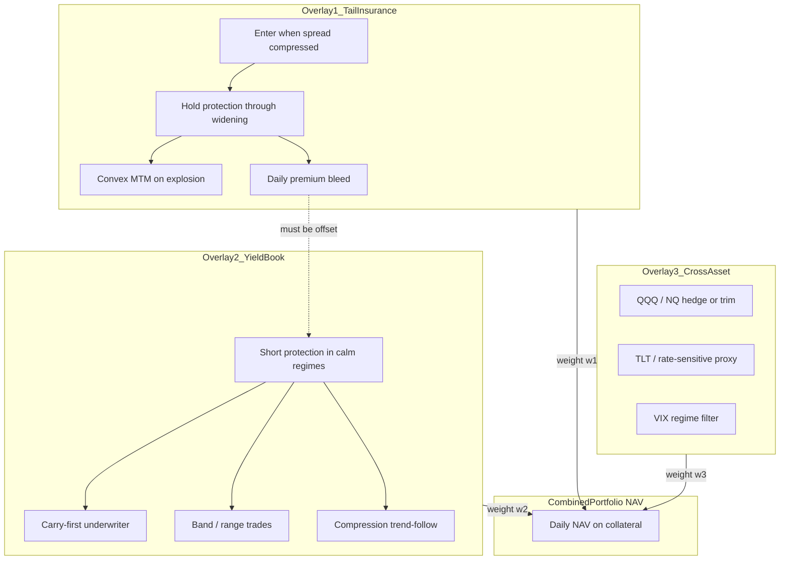

# CDX Multi-Overlay Portfolio — Analysis Plan

## Current status (2026-06-23)

| Phase | Status | Notes |
|-------|--------|-------|
| 1 — Data | ✅ | 3,622 rows, 2011-09-09 → 2026-03-15; panel + features parquet |
| 2 — Cost model | ✅ | `cds_cost_model.py`, COVID replay, 4 tests |
| 3a — Tail sweeps | ✅ | Best standing tail: NAV **1.92×** (`e60_x100`) |
| 3b — Yield library | ✅ | Y1–Y14 implemented; **Y8** leads (NAV **5.43×**, funding ratio **2.50**) |
| 4 — Portfolio | ✅ | `portfolio_backtest.py`; best mutex: NAV **1.94×**, COVID +$2.96M |
| 5 — Report | ✅ | manifest + index HTML + primary bundle |

**Tests:** 45/45 passing (`pytest analyses/cdx/tests/`)

**Run pipeline:**
```bash
.venv/bin/python analyses/cdx/run_phase1_data.py      # refresh parquet
.venv/bin/python analyses/cdx/run_phase2_cost_model.py
.venv/bin/python analyses/cdx/run_phase3_overlay_sweeps.py
.venv/bin/python analyses/cdx/run_phase4_portfolio.py
.venv/bin/pytest analyses/cdx/tests/ -q
```

**Key finding:** Portfolio **requires tail/yield mutex**. Without mutex, opposing legs inflate NAV (3.01×) with 1,296 overlap days; with mutex, NAV **1.94×** and COVID **+$2.96M** on $5M collateral.

---

Design and backtest a **composed CDX.NA.IG strategy** with 2–3 overlays whose PnL nets to the desired shape:

| Regime | Desired NAV behaviour |
|--------|----------------------|
| **Calm / low spread** | Flat or slowly rising equity curve (yield overlay + proxies fund the insurance carry) |
| **Stress / high spread** | Explosive upside when CDX.NA.IG enters elevated territory (tail overlay dominates) |

Holding **CDX.NA.IG protection** costs money every day (premium carry). That cost is not an afterthought — it is the central constraint the portfolio must solve. Overlay 2 exists specifically to pay for Overlay 1.

**Inputs already gathered** in [analyses/cdx/input/](analyses/cdx/input/):
- Nguyen paper brief — regime/velocity framework, NASDAQ overlay rules
- IndicatorBench — CDX.NA.IG history, 13 signal families, grid-search results
- Ackman notes — CDS economics, leverage, convex payoff math

---

## Instrument — CDX.NA.IG

**This analysis trades one instrument only:** the **Markit CDX.NA.IG** index — a standardized **index CDS** on **125** North American investment-grade corporate reference entities, quoted as a **5-year on-the-run par spread in basis points**.

| Property | Value |
|----------|-------|
| Official name | **CDX.NA.IG** (ICE Markit) |
| Tenor | **5-year** on-the-run |
| Roll schedule | March 20 / September 20 (IMM) |
| Price field | Index par spread (bps) |
| Data | [cdx_na_ig_clean.csv](analyses/cdx/input/indicatorbench/cdx/cdx_na_ig_clean.csv) |
| Catalog ID | `manual/CDX_NA_IG_5Y` |
| ICE product | [Markit CDX.NA.IG](https://www.ice.com/products/28555645/Markit-CDXNAIG) |

**Position semantics:**
- **Long protection** — long CDX.NA.IG spread → pay daily premium (carry), profit when spread **widens**
- **Short protection** — short spread → collect carry, profit when spread **tightens** (Overlay 2 yield book)

**Typical spread range (our sample):** ~44–152 bps; calm band ~50–80 bps; COVID peak ~152 bps (Mar 2020).

**Naming in this repo:** Always **`CDX.NA.IG`**. Do not use bare "CDX" in code, config, or reports.

### Source alignment

All input materials refer to the **same** instrument:

| Source | Instrument cited |
|--------|------------------|
| IndicatorBench | CDX.NA.IG daily spread from `CDX NA IG_historie.xlsx` |
| Nguyen (2026) | CDX.NA.IG 5Y on-the-run spread (bps) + NASDAQ Composite as overlay signal |
| Ackman notes | CDS protection economics at **IG spread levels** (~50 bps entry, ~150 bps panic) — we use these formulas applied to **CDX.NA.IG** |

Ackman notes are **economic inspiration** (carry, leverage, convex MTM: `PnL ≈ Δs × D × N`), not a mandate to replicate his full multi-index book. All backtests run on **CDX.NA.IG** only.

### Out of scope

- Other index CDS families, single-name CDS, non-NA indices
- Cleared-trade tape / exchange margin schedules (we use a parametric margin model)

---

## Strategic framing

Three overlays with **explicit capital allocation** and **PnL attribution**. Combined NAV is the research object, not any single leg.



**Design principle:** Overlay 1 alone will bleed carry in calm years. Overlay 2 **collects short-protection premium** in calm regimes (carry-first), optionally layered with tactical MTM rules. IndicatorBench-style z-score fades optimize spread MTM without CDS carry — they are **not** the primary yield design path. Overlay 3 uses correlated liquid proxies where direct CDX trading is uneconomic or lagged.

**Primary hypothesis:** A portfolio with `w1` tail insurance + `w2` yield book + optional `w3` cross-asset satellite can achieve near-flat calm-period NAV while retaining convex crisis payoff — **if and only if** the CDS cost model is realistic and overlay correlations in crises are managed (yield book must not blow up when tail book wins).

**Success criteria (research):**

| Metric | Target |
|--------|--------|
| Calm-year NAV (spread &lt; 80 bps, ex-COVID) | −3% to +8% annualized on collateral |
| Crisis episode uplift (COVID, 2022, 2025 tariff) | Combined NAV +50% to +300% on collateral over episode window |
| Full-sample max DD | &lt; 25% on combined book (yield overlay must cap left tail) |
| Carry funding ratio | Overlay 2 PnL / \|Overlay 1 carry\| ≥ 0.7 in calm years |
| OOS stability | Positive combined NAV in ≥ 2 of 3 walk-forward holdout blocks |

---

## The three overlays (definitions)

### Overlay 1 — Tail insurance (convex hold)

**Role:** Rare, expensive insurance book. Small weight in calm times; may scale up when spreads are historically cheap.

**Logic (starting point):**
- **Enter** long protection when `spread_bps < entry_max` (e.g. 55–65 bps) — buy cheap convexity
- **Hold** through widening; do not exit on first spike
- **Exit** on absolute level (e.g. &gt; 100–120 bps), trailing stop from peak, or max hold days
- **Sizing:** fixed notional or vol-scaled; separate collateral slice

**Ackman alignment:** Standing long CDX.NA.IG protection before explosion; pays carry; PnL ≈ Δs × D × N.

**IndicatorBench seed:** Adapt `sig_tail_hold` / standing logic — but enter **before** spike, not on spike.

### Overlay 2 — Yield book (calm-regime premium collection)

**Role:** Offset Overlay 1 carry by **earning short-protection premium** when IG credit is calm. The yield book is a **regime-gated underwriter**, not primarily a spike-fade engine.

**Economic target:** At $50M notional and ~60 bps spread, short protection earns ~**$833/day** carry (~$210k/year on the $1.75M yield collateral slice). The overlay does not need exotic signals — it needs **safe time-in-market short** with hard stress kill switches.

**Design rule (from ideation, 2026-06-23):** Regime-gated first, directional second. Any yield idea without a stress kill switch is out of scope.

**Universal gates (all yield variants):**
- **Flat** when `spread_bps ≥ 80` (stress level gate)
- **Flat** when `regime_velocity` = **high** (calm = low or moderate; 1d expanding σ)
- **Flat** when tail overlay is long protection (mutex — applied in Phase 4 portfolio; Y14 only in isolated sweeps)
- Optional: flat in `is_roll_window` (Mar/Sep 20 ± 2 days) — Y13

**Phase 3 v1 result (IndicatorBench port — baseline only):**
- `yield_zscore_fade` → NAV **0.77×**, carry funding ratio **−0.05**

**Phase 3b results (Y1–Y14, isolated overlay sweeps):**

| Rank | ID | Function | NAV end | vs Y1 | Carry funding |
|------|-----|----------|---------|-------|---------------|
| 1 | Y8 | `yield_velocity_filtered_underwriter` | **5.43×** | 2.43× | **2.50** |
| 2 | Y10 | `yield_risk_on_underwriter` | 5.04× | 2.26× | 2.27 |
| 3 | Y6 | `yield_peak_confirmed_fade` | 4.30× | 1.93× | 1.87 |
| — | **Y1** | `yield_calm_underwriter` (benchmark) | **2.23×** | 1.00× | **0.76** |
| — | v1 | `yield_zscore_fade` | 0.77× | 0.34× | −0.05 |

**Key constraint:** Overlay 2 must achieve **carry funding ratio ≥ 0.7** in calm years. Y1 achieves **0.76**; Y8 exceeds target.

---

## Yield strategy library (implemented)

**Location:** `src/signals_yield.py` + `src/yield_gates.py`  
**Registry:** `YIELD_STRATEGY_REGISTRY` — dispatch via `run_yield_strategy(name, ...)`

**Benchmark:** Y1 calm underwriter — any strategy must beat it with full CDS costs.

| ID | Registry key | Function | Status |
|----|--------------|----------|--------|
| Y1 | `Y1_calm_underwriter` | `yield_calm_underwriter` | ✅ benchmark |
| Y2 | `Y2_band_trader` | `yield_band_trader` | ✅ swept |
| Y3 | `Y3_compression_rider` | `yield_compression_rider` | ✅ swept |
| Y4 | — | `yield_with_tail_mutex` | ✅ wrapper (Phase 4) |
| Y5 | `Y5_timeboxed_scalp` | `yield_timeboxed_scalp` | ✅ swept |
| Y6 | `Y6_peak_fade` | `yield_peak_confirmed_fade` | ✅ swept |
| Y7 | `Y7_fade_rip` | `yield_fade_the_rip` | ✅ swept |
| Y8 | `Y8_velocity_filter` | `yield_velocity_filtered_underwriter` | ✅ **leader** |
| Y9 | `Y9_partial_notional` | `yield_partial_notional` | ✅ swept |
| Y10 | `Y10_risk_on` | `yield_risk_on_underwriter` | ✅ swept |
| Y11 | `Y11_divergence` | `yield_equity_credit_divergence` | ✅ swept |
| Y12 | `Y12_rates_aware` | `yield_rates_aware` | ✅ swept (negative NAV) |
| Y13 | `Y13_roll_season` | `yield_roll_season_carry` | ✅ swept |
| Y14 | `Y14_handoff` | `yield_handoff_to_tail` | ✅ needs portfolio tuning |
| v1 | `yield_zscore_fade` | `yield_zscore_fade` | ✅ baseline only |

**Timing convention:** `position[t]` uses data through close `t`; PnL applied same bar. All strategies have causal/lookahead unit tests.

**Deprioritized (IndicatorBench MTM-only):** z-score / RSI / BB fade, two-phase, OU continuous, ungated persistent short.

### Yield evaluation metrics (Phase 3 sweeps)

| Metric | Definition | Target |
|--------|------------|--------|
| `carry_funding_ratio` | yield calm PnL / \|tail calm carry\| | ≥ 0.7 |
| `calm_pnl_usd` | PnL when spread &lt; 80 bps | positive |
| `covid_pnl_usd` | 2020-02-01 → 2020-04-30 slice | minimize loss |
| `vs_y1_nav` | NAV end / Y1 NAV end | &gt; 1.0 to advance |

Sweep config: `config.yaml` → `yield_strategies:`

---

### Overlay 3 — Cross-asset proxies (satellite)

**Role:** Liquid instruments that move with credit stress; may provide cheaper beta or hedge Overlay 2 wrong-way risk.

**Candidates (data already in CryoQuant):**

| Proxy | Source | Use |
|-------|--------|-----|
| QQQ / NQ_F | `data/yahoo` | Nguyen trim/rebuild rules; short or underweight on CDX.NA.IG widening in stress |
| TLT | `data/yahoo` | Flight-to-quality / rates hedge during credit stress |
| VIX | `data/macro/cboe` | Regime filter — scale tail up, yield down when VIX compressed |
| SPY / XLF | `data/yahoo` | Broader equity credit beta (optional) |

**Not a full Nguyen replication in v1** — start with simple rules (e.g. long TLT when CDX.NA.IG 3d velocity &gt; +3% and QQQ underweight) and measure incremental PnL vs CDX.NA.IG-only portfolio.

---

## Folder structure

Follow [analyses/trend_following/PLAN.md](analyses/trend_following/PLAN.md) discipline: prototype locally, promote to `cryoquant/` when reusable.

```
analyses/cdx/
├── PLAN.md                         # Living plan (this doc)
├── RESULTS.md                      # Phase findings (git-tracked)
├── config.yaml                     # Economics, overlays, yield_strategies
├── input/                          # Reference materials (read-only)
├── data/                           # gitignored — parquet, sweep CSVs
├── src/
│   ├── paths.py                    # load_config(), path helpers
│   ├── ingest.py                   # CDX.NA.IG + macro alignment
│   ├── features.py                 # Regimes, velocity (1d σ), roll flags
│   ├── cds_cost_model.py           # Carry, MTM, costs, margin
│   ├── yield_gates.py              # Shared calm gates, mutex, causal helpers
│   ├── signals_tail.py             # Overlay 1 — standing insurance, tail_hold
│   ├── signals_yield.py            # Overlay 2 — Y1–Y14 + registry
│   ├── backtest_cds.py             # Single-overlay simulator (CdsOverlayResult)
│   ├── portfolio_backtest.py       # Phase 4 — tail + yield, mutex, walk-forward
│   ├── metrics_portfolio.py        # Funding ratio, episodes, regime PnL
│   ├── signals_proxy.py            # Overlay 3 — NOT YET BUILT
├── tests/
│   ├── conftest.py
│   ├── test_cds_cost_model.py      # 4 tests
│   ├── test_features.py            # velocity regime
│   ├── test_yield_gates.py         # gate edge cases
│   └── test_portfolio_backtest.py  # Mutex, attribution, walk-forward
├── run_phase1_data.py
├── run_phase2_cost_model.py
├── run_phase3_overlay_sweeps.py    # Tail grid + all yield strategies
├── run_phase4_portfolio.py         # Portfolio variants + walk-forward OOS
├── run_phase5_report.py            # manifest.json, index HTML, primary bundle
└── reports/                        # gitignored — phase JSON outputs
```

**Pipeline mapping to CryoQuant:**

```
data (ingest + macro_store)
  → features (features.py)
  → signals (signals_tail / yield / proxy)
  → backtest (backtest_cds + portfolio_backtest)
  → reports (metrics + HTML)
```

---

## Data requirements

### Core series (Phase 1)

| Series | ID | Source | Status |
|--------|-----|--------|--------|
| CDX.NA.IG 5Y spread | `CDX_NA_IG_5Y` | [cdx_na_ig_clean.csv](analyses/cdx/input/indicatorbench/cdx/cdx_na_ig_clean.csv) | In input |
| CDX.NA.IG raw audit | xlsx | `CDX NA IG_historie.xlsx` | In input |
| QQQ | `yahoo_QQQ` | CryoQuant `data/yahoo` | Exists |
| NQ futures | `yahoo_NQ_F` | CryoQuant `data/yahoo` | Exists |
| TLT | `yahoo_TLT` | CryoQuant `data/yahoo` | Exists |
| VIX | `VIX_CLOSE` | CryoQuant `data/macro/cboe` | Exists |

**Ingest:** `src/ingest.py` writes CDX.NA.IG to [macro_store](cryoquant/data/macro_store.py) (`source=manual`, `series_id=CDX_NA_IG_5Y`). Cross-asset series loaded via existing loaders; daily align on US equity calendar with forward-fill for CDX.NA.IG-only gaps.

### Derived features (`features.py`)

| Feature | Use |
|---------|-----|
| `spread_bps`, `d_spread_1d` | MTM, carry |
| `pct_chg_1d`, `pct_chg_3d` | Velocity signals (percent scale) |
| `level_pctile_expanding` | OOS-safe compressed-spread detection |
| `regime_level` | Tight (&lt;50) / Normal (&lt;80) / Elevated (&lt;120) / Stress |
| `regime_velocity` | Low / Moderate / High — expanding σ of **1d** % change (decimal buckets) |
| `is_roll_window` | Mar 20 / Sep 20 ± 2 days |
| `carry_daily_per_1m` | Pre-computed carry per $1M notional |

**Note:** `regime_velocity` calm gate treats **low + moderate** as allowed; **high** blocks yield entry.

### Data QA gates (before any backtest)

- No duplicate dates; monotonic index
- Flag `gap_days > 4`; exclude or mark roll-adjacent rows in sensitivity runs
- Compare clean CSV tail vs xlsx on refresh
- **Current policy (2026-06-23):** use manual `cdx_na_ig_clean.csv` through **2026-03-15**; no live API refresh required for Phases 3–5

---

## CDS cost model (first-class module)

`cds_cost_model.py` is the foundation. **Every overlay** routes through it. IndicatorBench's `pos × pct_change` is explicitly **not** used for final results.

### Daily PnL components (per overlay leg)

```python
carry_t      = -position_notional * (spread_bps_t / 10_000) / day_count   # long protection pays
mtm_t        = position_notional * duration * (spread_bps_t - spread_bps_{t-1}) / 10_000
trade_cost_t = -notional * (bid_ask_bps / 10_000)   # on |Δposition| > 0
roll_cost_t  = -notional * (roll_cost_bps / 10_000) # if held through IMM roll
finance_t    = -collateral_posted * (financing_rate / day_count)        # optional
margin_call_t = f(vm_breach)                       # forced delever if enabled
```

**Position convention:**
- `+1` = long protection (long spread, profits when spread widens)
- `-1` = short protection (short spread, profits when spread tightens) — Overlay 2 yield book

### `config.yaml` — economics block

```yaml
cds_economics:
  duration: 5.0
  day_count: 360
  collateral_usd: 5_000_000        # total portfolio collateral

costs:
  # Holding cost — the reason Overlay 2 exists
  carry_accrual: spread_proportional   # spread_bps/10000 * notional / 360
  bid_ask_bps: 0.5                     # per notional change (one-way)
  roll_cost_bps: 1.0                   # Mar/Sep if position held
  financing_rate: 0.05                 # on posted collateral

margin:
  im_pct_calm: 0.03
  im_pct_stress: 0.10
  stress_spread_bps: 100
  force_delever: true

overlays:
  tail:
    notional_usd: 100_000_000
    collateral_slice_pct: 0.50         # half of capital reserved for tail margin
  yield:
    notional_usd: 50_000_000           # smaller book, higher turnover
    collateral_slice_pct: 0.35
  proxy:
    collateral_slice_pct: 0.15
    instruments: [QQQ, TLT]
```

### Phase 2 validation (`run_phase2_cost_model.py`)

1. **CDX.NA.IG replay** — $100M notional, enter ~50 bps Feb 2020, hold to ~152 bps; compare PnL to `Δs × D × N`
2. **Carry bleed table** — annual cost at 50/60/70/80 bps spread levels (% of collateral)
3. **Cost sensitivity grid** — bid-ask 0.25–1.0 bps, duration 4–6, financing on/off
4. **Unit tests** in `tests/test_cds_cost_model.py` — carry sign, MTM direction, zero position = zero carry

---

## Backtest methodology (data science discipline)

### Per-overlay backtests (Phase 3)

Each overlay runs **in isolation** through `backtest_cds.py` with identical cost model. **Data:** manual CDX.NA.IG CSV through **2026-03-15** (no live feed).

**Phase 3a — complete (tail + yield v1 baseline):**

| Overlay | Strategies tested | Date range | Key result |
|---------|-------------------|------------|------------|
| Tail | Standing insurance grid (entry 60/65/70 × exit 100/120) + `tail_hold_spike` | 2011-09-09 → 2026-03-15 | Best: `e60_x100` NAV **1.92×**; COVID +$2.97M on $2.5M tail slice |
| Yield v1 | `yield_zscore_fade` only (IndicatorBench port) | same | NAV **0.77×** — fails carry funding objective |

**Phase 3b — complete (yield Y1–Y14 library):**

| Overlay | Signal source | Key result |
|---------|---------------|------------|
| Yield v2 | `signals_yield.py` + `yield_gates.py` | **Y8** NAV **5.43×**, funding **2.50**; Y1 benchmark **2.23×**, funding **0.76** |
| All 14 strategies | `YIELD_STRATEGY_REGISTRY` | Swept in isolation (no tail mutex except Y14) |

**Phase 4 — complete (portfolio composition):**

| Variant | NAV end | Mutex | COVID PnL | Carry funding | Overlap days |
|---------|---------|-------|-----------|---------------|--------------|
| tail_y8_mutex | **1.94** | yes | +$2.96M | 0.83 | 0 |
| tail_y10_mutex | 1.91 | yes | +$2.96M | 0.78 | 0 |
| tail_y1_mutex | 1.85 | yes | +$2.96M | 0.69 | 0 |
| tail_y8_no_mutex | 3.01 | no | +$3.05M | 2.50 | **1296** |

Walk-forward OOS (`tail_y8_mutex`): 3 blocks, stitched NAV end **1.65×**.

**Phase 5 — next:**

**Evaluation per overlay** (via [compute_metrics](cryoquant/backtest/metrics.py)):
- `cagr`, `sharpe_equity`, `max_drawdown`, `calmar` on daily NAV
- Overlay-specific: `annual_carry_paid`, `crisis_episode_pnl`, `n_trades`, `win_rate`
- **Yield-specific:** `carry_funding_ratio`, `calm_pnl_usd`, `stress_pnl`, vs Y1 benchmark
- **Regime-conditional metrics:** calm-only vs stress-only Sharpe and return

**Walk-forward:** Expanding-window train (e.g. 8y) → test (3y) blocks. Thresholds (`entry_max`, z-scores) fit on train only.

### Portfolio composition (Phase 4)

`portfolio_backtest.py`:

```python
nav_t = nav_{t-1} + w1*pnl_tail_t + w2*pnl_yield_t + w3*pnl_proxy_t
```

**Weight modes to test:**
1. **Fixed weights** — e.g. w1=0.5, w2=0.35, w3=0.15
2. **Regime-scaled** — increase w1 when spread percentile &lt; 30%; cut w2 when velocity High-Stress
3. **Carry-budget** — scale w2 to target `yield_pnl ≥ 0.8 × |tail_carry|` in trailing 252d

**PnL attribution (required output):**
- Daily and cumulative: `pnl_tail`, `pnl_yield`, `pnl_proxy`, `costs_total`
- Crisis episodes: which overlay contributed what %

**Interaction tests (critical):**
- Correlation of Overlay 1 and 2 daily PnL in stress (must not be strongly negative)
- Yield overlay drawdown during COVID (Overlay 2 should be flat or off, not -70%)

### Robustness checklist (Phase 5)

- [ ] Cost model sensitivity (all cost params ±50%)
- [ ] Roll-date exclusion on/off
- [ ] Expanding vs full-sample percentiles
- [ ] Bootstrap on crisis episodes (not i.i.d. daily — block bootstrap by episode)
- [ ] [deflated_sharpe](cryoquant/backtest/robustness.py) on yield overlay trade subsample (many trades)
- [ ] Subsample stability: drop 2020, drop 2022, re-run portfolio

---

## CryoQuant framework integration

### Use existing modules

| Module | Role in this analysis |
|--------|----------------------|
| [macro_store](cryoquant/data/macro_store.py) | Persist CDX.NA.IG spread series |
| [catalog](cryoquant/data/catalog.py) | Track dataset metadata |
| Yahoo / CBOE loaders | QQQ, TLT, VIX ingest |
| [compute_metrics](cryoquant/backtest/metrics.py) | Standard KPIs on combined equity |
| [deflated_sharpe](cryoquant/backtest/robustness.py) | Yield overlay (high trade count) |
| [bootstrap_ci](cryoquant/backtest/robustness.py) | Episode return confidence |
| [reports](cryoquant/backtest/reports.py) | HTML report template (adapt) |
| [trades.enrich_trades](cryoquant/backtest/trades.py) | Per-overlay trade logs |

### Return type compatibility

`backtest_cds.py` should emit a result struct compatible with existing reporting:

```python
@dataclass
class CdsOverlayResult:
    name: str
    equity: pd.Series          # daily NAV, starts at 1.0
    trades: pd.DataFrame       # entry_ts, exit_ts, pnl_pct, side, overlay
    daily_attribution: pd.DataFrame  # carry, mtm, costs columns
    positions: pd.Series
    metrics: dict              # from compute_metrics()
```

`portfolio_backtest.py` merges overlay results → single `equity` + attribution DataFrame.

### Promote to framework when stable

| Component | Promote to | Trigger |
|-----------|------------|---------|
| `cds_cost_model.py` | `cryoquant/backtest/cds_cost_model.py` | Used in tests, API frozen |
| CDX.NA.IG ingest | `cryoquant/data/sources/manual.py` or csv loader | Second analysis needs it |

### Do not use (wrong instrument fit)

- `spot_pnl.simulate` — no CDS carry or duration
- IndicatorBench `backtest.run` — spread-% PnL without costs
- Raw IndicatorBench Sharpe numbers — must be re-computed with cost model

---

## Implementation phases

| Phase | Script | Status | Deliverable |
|-------|--------|--------|-------------|
| **1 — Data** | `run_phase1_data.py` | ✅ | macro_store, panel/features parquet, QA JSON |
| **2 — Cost model** | `run_phase2_cost_model.py` | ✅ | COVID replay, carry tables, 4 tests |
| **3 — Overlay sweeps** | `run_phase3_overlay_sweeps.py` | ✅ | Tail grid + Y1–Y14 yield leaderboard, funding ratio |
| **4 — Portfolio** | `run_phase4_portfolio.py` | ✅ | Mutex variants, walk-forward OOS, attribution |
| **5 — Report** | `run_phase5_report.py` | ✅ | manifest, index HTML, primary attribution bundle |

---

## Key risks (document in RESULTS)

| Risk | Mitigation |
|------|------------|
| Yield overlay blows up in crisis (short protection into widening) | Regime gate: disable Overlay 2 when spread &gt; 80 bps or High velocity σ |
| Carry cannot be funded — portfolio still bleeds | Optimize w2 for carry funding ratio; report years where funding fails |
| Overlay 1 + 2 correlation in stress | Attribution dashboard; correlation matrix by regime |
| Roll-date artifacts inflate yield Sharpe | `is_roll_window` exclusion in sensitivity |
| Look-ahead on spread percentiles | Expanding-window only in OOS |
| Proxy lag vs CDX.NA.IG | Measure lead/lag; proxy is satellite, not replacement |
| Low trade count on tail overlay | Episode bootstrap, not DSR, for tail leg |

---

## What changed from prior plan version

- **Single standing insurance** → **three-overlay portfolio** with explicit funding problem
- **Carry as first-class cost model** driving Overlay 2 design
- **IndicatorBench fades deprioritized** — MTM-only metrics; `yield_zscore_fade` → 0.77× NAV
- **Yield library built (2026-06-23):** Y1–Y14 in `signals_yield.py`; Y8 velocity filter leads sweeps
- **`regime_velocity` fix:** 1d expanding σ (decimal scale); calm = low ∪ moderate
- **36 unit tests:** cost model, gates, causal/lookahead per strategy, features
- **Data policy:** manual CSV through 2026-03-15; no live API for Phases 3–5
- **Phase 4 next:** portfolio composition with tail/yield mutex
