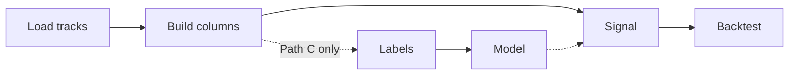

# How to Build a Study — From Data to Signal

**Audience:** You have a hypothesis, a new data track, or a mix of series — and you want a
backtested signal out the other end.

This is the **cookbook** for a new study. For API reference and layer-by-layer detail, use
[how_to_use.md](how_to_use.md). For terms, see [glossary.md](glossary.md).

---

## The pipeline (all paths)



| Step | Path A (quick) | Path B (sweep) | Path C (ML) |
|---|---|---|---|
| Data | `load_track` × 2–5 | `ingest` + universe YAML | `DataPanel` / `load_tracks` |
| Features | inline `primitives` | `FeatureBuilder` / `trend_builders` | composed builders |
| Model | skip | optional | `walk_forward_fit` |
| Signal | `BoolSignal` / `ScoreSignal` | same + sweep grids | `ProbSignal` |
| Backtest | `simulate` | `breakout_sim` + `bundle` | `simulate` |

Pick your path first: [how_to_use.md §2](how_to_use.md#2-choose-your-path).

---

## 1. Get data into CryoQuant

### 1a — Use an existing instrument

Most studies start here. Check registered symbols in `cryocore/instruments.py`, then load:

```python
from datetime import datetime, timezone
from cryocore.instruments import Symbol
from cryoquant.data.resolve import load_track

start = datetime(2024, 1, 1, tzinfo=timezone.utc)
end   = datetime.now(timezone.utc)

btc = load_track(Symbol("binance.spot", "BTCUSDT"), "1h", start, end)   # OHLCV DataFrame
vix = load_track(Symbol("yahoo", "^VIX"), "1d", start, end)           # macro → Series
```

`load_track` routes automatically: Binance/Yahoo → partitioned OHLCV parquet; FRED/CBOE/manual → `macro_store`.

First call fetches from the network and caches under `data/` (or `CRYOQUANT_STORE_ROOT`). Later calls read disk only.

```bash
python -m cryoquant.cli catalog list
```

### 1b — One-off CSV or proprietary file (analysis-local)

For a study-only file you will not reuse elsewhere, **do not** add a framework source module yet.
Load in `analyses/<name>/` and optionally write to `macro_store` for caching:

```python
import pandas as pd
from cryoquant.data.macro_store import write_series, load_series

raw = pd.read_csv("analyses/my_study/input/spreads.csv", parse_dates=["date"], index_col="date")
raw.index = raw.index.tz_localize("UTC")
series = raw["spread_bps"].astype("float64")

write_series("manual", "my_spread", series, force=True)

# Later runs
spread = load_series("manual", "my_spread", start, end)
```

Register a `manual` instrument if you want `load_track` routing:

```python
# cryocore/instruments.py — only when promoting to framework
Instrument(
    Symbol("manual", "my_spread"),
    asset_class="macro",
    quote_currency="USD",
    calendar="nyse",
    meta={"storage": "macro"},
)
```

### 1c — Add a ticker on an existing venue

New Yahoo ETF, new FRED series — add one line to `_INSTRUMENTS` in `cryocore/instruments.py`:

```python
Instrument(Symbol("yahoo", "HYG"), "equity", "USD", "nyse"),
Instrument(Symbol("fred", "T10Y2Y"), "macro", "USD", "nyse"),
```

Then `load_track(Symbol("yahoo", "HYG"), "1d", start, end)` works. No loader changes needed.

### 1d — Add a new OHLCV source (framework change)

Only when **two analyses** need the same venue, or the fetch/normalise logic is generic:

1. **Source module** — `cryoquant/data/sources/<name>.py` with `fetch_bars(symbol, tf, start, end) -> DataFrame`
   - UTC tz-aware bar-open index named `timestamp`
   - Columns: `open`, `high`, `low`, `close`, `volume` as `float64`
   - Drop the in-progress bar
   - Copy patterns from [`yahoo.py`](../cryoquant/data/sources/yahoo.py) or [`binance_spot.py`](../cryoquant/data/sources/binance_spot.py)

2. **Loader routing** — wire the venue in [`loader.py`](../cryoquant/data/loader.py) `_fetch_raw()`.

3. **Instrument** — register `Symbol(venue, ticker)` with correct `asset_class` and `calendar`.

4. **Tests** — offline tests with mocked HTTP or fixture parquets in `tests/test_data_sources_*.py`.

5. **Cleaning** — if the venue has quirks (FX inversion, spike thresholds), extend [`cleaning.py`](../cryoquant/data/cleaning.py).

### 1e — Batch ingest many symbols (Path B)

For parameter sweeps across a universe, use YAML + `ingest`:

```yaml
# analyses/my_study/universe.yaml
groups:
  crypto_hourly:
    tf: 1h
    symbols:
      - binance.spot:BTCUSDT
      - binance.spot:ETHUSDT
  macro_daily:
    symbols:
      - fred:VIX
      - yahoo:SPY
```

```python
from pathlib import Path
from cryoquant.data.ingest import run_ingest

result = run_ingest(Path("analyses/my_study/universe.yaml"))
print(result.ok, result.failed)
```

See `analyses/trend_following/run_ingest.py` for a thin CLI wrapper pattern.

---

## 2. Combine tracks on one timeline

When your primary series is intraday and overlays are daily or macro:

```python
from cryoquant.features.align import align_series

btc["vix"] = align_series(btc.index, vix, method="asof", ffill_limit=35)
```

For many tracks (Path C):

```python
from cryoquant.features.panel import DataPanel
from cryocore.instruments import Symbol

panel = DataPanel.from_loads([
    (Symbol("binance.spot", "BTCUSDT"), "1h"),
    (Symbol("yahoo", "^VIX"), "1d"),
    (Symbol("fred", "DGS10"), "1d"),
], start, end)

btc = panel.align_track("binance.spot:BTCUSDT@1h", panel.tracks["yahoo:^VIX"])
```

Reference: [`scripts/quick_indicator.py`](../scripts/quick_indicator.py), [`scripts/ml_multi_source.py`](../scripts/ml_multi_source.py).

---

## 3. Build feature columns

### Quick rule studies — inline primitives

```python
from cryoquant.features.primitives import ema, rsi, atr

bars["ema_24"] = ema(bars["close"], 24)
bars["rsi_14"] = rsi(bars["close"], 14)
bars["atr_14"] = atr(bars, 14)
```

No `FeatureBuilder`, no cache — fine for Path A.

### Reusable or expensive sets — builders

When you need versioning, caching, or multi-frame composition:

```python
from cryoquant.features.builders import DatasetRef, SpotFeatures

ref = DatasetRef(Symbol("binance.spot", "BTCUSDT"), "1h")
X = SpotFeatures().build({ref: bars})
bars = bars.join([c for c in X.columns if c not in bars.columns])
```

Trend/macro/cross-asset stacks: `cryoquant.features.trend_builders`.

### ML only — labels

Forward-looking labels belong **only** in the training target, never as model features:

```python
from cryoquant.features.labels import ForwardReturnLabeler

labeler = ForwardReturnLabeler(horizon_h=24, threshold=2.5, direction="up")
bars["label"] = labeler.apply(bars)
clean = bars.dropna(subset=["label"])
```

---

## 4. Turn columns into a signal

Signals are **functional** — pass a callable; do not subclass.

| Flavour | Use when | Constructor |
|---|---|---|
| `BoolSignal` | Rule on/off | `condition=lambda df: ...` |
| `ScoreSignal` | Raw indicator value | `score_fn=lambda df: df["rsi_14"]` |
| `StateSignal` | Regime / discrete state | `state_fn=lambda df: ...` |
| `ProbSignal` | Calibrated ML probability | `prob_from_model(model, ...)` |

**Path A — rule signal:**

```python
from cryoquant.signals.base import BoolSignal

signal = BoolSignal(
    signal_id="btc_rsi_vix_v1",
    condition=lambda df: (df["rsi_14"] < 35) & (df["vix"] < 20),
    version="1",
    symbol_str="binance.spot:BTCUSDT",
)
```

**Path C — model signal:**

```python
from cryoquant.models.fit_loop import walk_forward_fit, concat_oos_probs
from cryoquant.models.tabular import TabularModel
from cryoquant.signals.from_model import prob_from_model

results = walk_forward_fit(TabularModel, X, y, train_window_bars=180, test_window_bars=30, step_bars=30)
model.fit(X, y)  # final fit on full sample for live emit, if desired
signal = prob_from_model(model, horizon_h=24, default_threshold=0.55)
```

Full signal API: [how_to_use.md §9](how_to_use.md#9-creating-signals).

---

## 5. Backtest and validate

```python
from cryoquant.backtest.spot_pnl import simulate
from cryoquant.backtest.robustness import deflated_sharpe
from cryoquant.backtest.reports import render_spot_result

result = simulate(signal, bars, hold_h=24, fee_bps=5.0)
print(result.metrics)

dsr = deflated_sharpe(
    sharpe=result.metrics["sharpe"],
    n_trials=10,   # how many variants you tried
    n_obs=len(result.trades),
)
render_spot_result(result, "analyses/my_study/reports/run_001.html")
```

Options follow-through (Deribit chains): [how_to_use.md §11](how_to_use.md#11-options-backtesting).

---

## 5b. Publish artifacts

After backtesting, write human- and machine-readable outputs under `analyses/<name>/reports/`.
See [how_to_report.md](how_to_report.md) for the full format menu.

**Path A — minimum:**

```python
from cryoquant.backtest.reports import render_spot_result

render_spot_result(result, "analyses/my_study/reports/run_001.html")
```

**Path B — sweep bundle:**

```python
from cryoquant.backtest.bundle import write_bundle
from cryoquant.backtest.reports import render_sweep_leaderboard

write_bundle("analyses/my_study/bundles/main", bundle)
render_sweep_leaderboard(bundle, "analyses/my_study/bundles/main/report.html")
```

**Multi-bundle index (optional):**

```python
from cryoquant.reporting import publish_study

publish_study("analyses/my_study", manifest=manifest)  # or rely on reporting: in config.yaml
```

---

## 6. Where code lives

```text
analyses/<name>/
  universe.yaml          # Path B ingest manifest (optional)
  run_ingest.py          # thin CLI wrapper (optional)
  backtest.py            # entry point for this study
  exploration.ipynb      # parameter sweeps
  bundles/               # RunBundle dirs (gitignored)
  reports/               # manifest, index HTML, phase JSON (gitignored)
  input/                 # study-local raw files (optional)

cryoquant/               # promote here when reusable
  reporting/             # manifest, index HTML, phase summaries, charts
  data/sources/          # new venue fetchers
  features/builders.py   # shared feature sets
  signals/               # signal factories used by multiple analyses
```

**Promote rule:** move code into `cryoquant/` when a second analysis needs it, or when it has zero domain semantics (alignment, metrics, ingest helpers). Keep hypothesis-specific economics in `analyses/`.

---

## 7. Checklists

### Path A — quick indicator

```
[ ] load_track for each series; align_series for overlays
[ ] Primitives or a few inline columns on the primary frame
[ ] BoolSignal or ScoreSignal
[ ] simulate() + deflated_sharpe
[ ] HTML report under analyses/<name>/reports/ (see how_to_report.md)
```

### Path B — sweep study

```
[ ] universe.yaml + run_ingest
[ ] FeatureBuilder(s) or trend_builders
[ ] breakout_sim or simulate + sweep_collector
[ ] score_leaderboard + bundle artifacts (how_to_report.md)
[ ] optional: manifest.json + index.html
```

### Path C — ML indicator

```
[ ] DataPanel or batch ingest for 10+ tracks
[ ] Labels + walk_forward_fit (no label columns in X)
[ ] prob_from_model → simulate
[ ] Optional: model registry for artifact tracking
```

### Framework contributor — new data source

```
[ ] fetch_bars / fetch_series in data/sources/
[ ] loader routing + Instrument registration
[ ] cleaning rules if needed
[ ] Offline tests with fixtures
[ ] Document venue + ticker examples in this file or how_to_use §5
```

---

## 8. Optional — publish signal history

For CSV export or downstream consumers:

```python
from cryoquant.signals.publishers.csv_emitter import emit_history

emit_history(signal, bars, out_path="analyses/my_study/signal_history.parquet")
```

CryoTrader live wiring is deferred; see [how_to_use.md §12](how_to_use.md#12-publishing-a-signal).

---

## See also

| Doc | When |
|---|---|
| [how_to_use.md](how_to_use.md) | Full reference for every layer |
| [how_to_report.md](how_to_report.md) | Artifact layout and report format menu |
| [glossary.md](glossary.md) | `Symbol`, `DatasetRef`, paths A/B/C |
| [../scripts/](../scripts/) | Runnable reference implementations |
| [archive/](archive/) | Historical phase plans (contributors) |
