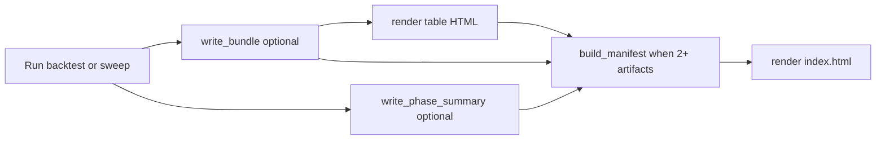

# How to Report — Study Artifacts and Formats

**Audience:** You have backtest or sweep results and want a consistent, shareable output layout.

This is a **guideline**, not a runtime requirement. Pick any subset of formats. For the study pipeline, see [how_to_build_a_study.md](how_to_build_a_study.md).

**Reference implementation:** [`studies/cdx/`](../studies/cdx/) — multi-phase study with manifest, index HTML, bundles, and narrative reports.

---

## Design principle

**Strict artifact contract, loose presentation.**

- Machine-readable outputs (`RunBundle`, `manifest.json`, phase JSON) use stable paths and schemas.
- HTML style is pluggable — table reports, inline SVG charts, study-specific narrative pages.
- Nothing is enforced at import time; studies opt in via their own scripts or optional `reporting:` config.

---

## Recommended layout

```text
studies/<study>/
├── config.yaml
├── data/                          # gitignored — derived parquets
├── bundles/<name>/                  # RunBundle dirs (gitignored)
│   ├── meta.json
│   ├── leaderboard.{parquet,csv}
│   ├── trades.parquet
│   ├── equity_daily.parquet
│   └── report.html                  # tier: table_html
├── reports/                         # gitignored
│   ├── manifest.json                # study index (machine)
│   ├── index.html                   # study index (human)
│   ├── phase_<n>_<name>.json        # per-phase summaries
│   └── notebooks/<name>.html        # optional notebook export
└── exploration.ipynb                # committed — interactive tier
```

Path A (single run) can omit `manifest.json` and write only `reports/<run_id>.html`.

---

## Format menu

| Tier | ID | When to use | Framework API |
|------|-----|-------------|---------------|
| 0 | `bundle` | Parameter sweeps, leaderboards | `cryoquant.backtest.bundle.write_bundle` |
| 1 | `summary_json` | Per-phase machine summary | `cryoquant.reporting.write_phase_summary` |
| 2 | `table_html` | Quick review, sweep tables | `cryoquant.backtest.reports.render_*` |
| 3 | `chart_html` | Self-contained equity/bar charts | `cryoquant.reporting.charts` (inline SVG) |
| 4 | `study_html` | Narrative “what we learned” | Study-local (CDX: `study_report_html.py`) |
| 5 | `pitch_html` | External / fund memo | Study-local (CDX: `crunch_fund_report_html.py`) |
| 6 | `notebook` | Interactive exploration | Committed `.ipynb` |
| 7 | `notebook_html` | Share executed notebook | `cryoquant.reporting.export_notebook` — needs `[reports]` |
| 8 | `tearsheet` | Return-series risk analytics | `cryoquant.reporting.render_tearsheet` — needs `[reports]` |

### Defaults by workflow path

| Path | Minimum | Nice to have |
|------|---------|--------------|
| **A — Quick** | `table_html` | `summary_json` |
| **B — Sweep** | `bundle` + `table_html` | `manifest.json` + `index.html` |
| **B — Multi-phase** | Above + phase JSON | `chart_html` or `study_html` |
| **C — ML** | `bundle` + OOS metrics JSON | `tearsheet` on stitched OOS equity |

---

## Optional config (documented convention)

Studies may declare intent in `config.yaml`. The framework does not validate this at runtime.

```yaml
reporting:
  study: my_study
  formats:
    - bundle
    - table_html
    - summary_json
  index: true
  charts: inline_svg
  sample:
    start: "2020-01-01"
    end: "2024-01-01"
    n_bars: 1008
    label: "2020 → 2024"
  bundles:
    main_sweep: bundles/main_sweep
```

---

## Framework APIs

### RunBundle (tier 0 + 2)

Sweep output directory contract — see [`cryoquant/backtest/bundle.py`](../cryoquant/backtest/bundle.py).

```python
from cryoquant.backtest.bundle import RunBundle, write_bundle
from cryoquant.backtest.reports import render_sweep_leaderboard

bundle = RunBundle(meta={"study": "demo", "n_runs": 10}, leaderboard=lb, trades=trades)
write_bundle("studies/my_study/bundles/main", bundle)
render_sweep_leaderboard(bundle, "studies/my_study/bundles/main/report.html")
```

Recommended `meta.json` keys: `study`, `n_runs`, `scoring`, plus optional `sample`, `data_sources`, `warnings`, `git_commit`, `config_hash`.

### Phase summary (tier 1)

```python
from cryoquant.reporting import write_phase_summary

write_phase_summary(
    "studies/my_study/reports/phase_1_ingest.json",
    phase_id="ingest",
    metrics={"n_bars": 2520},
    artifacts={"panel": "data/panel.parquet"},
    status="ok",
)
```

### Study manifest + index (tiers 0–2 index)

```python
from pathlib import Path
from cryoquant.reporting import (
    build_manifest,
    bundle_status,
    write_manifest,
    render_index_from_manifest,
)

reports_root = Path("studies/my_study/reports")
bundle_dir = Path("studies/my_study/bundles/main")

manifest = build_manifest(
    study="my_study",
    sample={"start": "2020-01-01", "end": "2024-01-01", "n_bars": 1008, "label": "2020 → 2024"},
    bundles={"main": bundle_status(bundle_dir, reports_root=reports_root)},
    highlights={"top_sharpe": 1.4},
    reports={"index": "index.html", "main": bundle_status(bundle_dir, reports_root=reports_root).get("report_html")},
)
write_manifest(reports_root / "manifest.json", manifest)
render_index_from_manifest(
    reports_root / "index.html",
    manifest,
    sections=[{"name": "Main sweep", "description": "Grid", "href": "bundles/main/report.html", "status": "ok"}],
)
```

Or use the orchestrator when `reporting:` is in config:

```python
from cryoquant.reporting import publish_study

publish_study("studies/my_study")  # reads config.yaml, writes manifest + index
```

### Inline SVG charts (tier 3)

```python
from cryoquant.reporting.charts import svg_line_chart, svg_bars

html_fragment = svg_line_chart(equity_series, y_label="NAV", hline=1.0)
```

Zero extra dependencies — suitable for self-contained HTML reports.

### Optional extras (`pip install 'cryoquant[reports]'`)

```python
from cryoquant.reporting import export_notebook, render_tearsheet

export_notebook("studies/my_study/exploration.ipynb", "studies/my_study/reports/notebooks/exploration.html")
render_tearsheet(daily_returns, "studies/my_study/reports/tearsheet.html", benchmark="SPY")
```

---

## Manifest schema (convention)

```json
{
  "study": "string",
  "bundle_version": "1",
  "created_at": "ISO-8601",
  "sample": { "start": "...", "end": "...", "n_bars": 0, "label": "..." },
  "highlights": {},
  "phases": [],
  "bundles": {
    "<name>": {
      "status": "ok|missing|incomplete",
      "path": "...",
      "report_html": "bundles/<name>/report.html"
    }
  },
  "reports": { "index": "index.html" }
}
```

---

## Process flow



---

## Checklists

### Path A — single run

```
[ ] render_spot_result → reports/<run_id>.html
[ ] optional: write_phase_summary or inline metrics JSON
```

### Path B — sweep

```
[ ] write_bundle + render_sweep_leaderboard → bundles/<name>/
[ ] optional: write_phase_summary per pipeline step
[ ] manifest.json + index.html when multiple bundles or phases
```

### Sharing exploration

```
[ ] exploration.ipynb committed (outputs cleared)
[ ] optional: export_notebook → reports/notebooks/ when sharing
```

---

## Git policy

- **Commit:** `RESULTS.md`, study docs, `config.yaml`, source notebooks (cleared outputs).
- **Gitignore:** `studies/*/reports/`, `studies/*/data/`, `bundles/` (see root `.gitignore`).

---

## See also

| Doc | When |
|-----|------|
| [how_to_build_a_study.md](how_to_build_a_study.md) | End-to-end study pipeline |
| [glossary.md](glossary.md) | `RunBundle`, `StudyManifest`, tier IDs |
| [../studies/cdx/RESULTS.md](../studies/cdx/RESULTS.md) | Full multi-phase reference |
