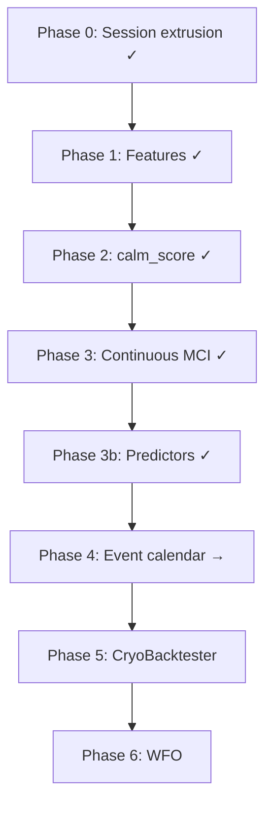

# Tudysho calm nights — research plan

**CryoQuant study:** `studies/tudysho_calm_nights/`  
**Reference package:** [`package/`](package/) (strategy params, turbulence snapshot)  
**Config:** [`config.yaml`](config.yaml)  
**Event calendar:** [`CALENDAR.md`](CALENDAR.md)

**Analysis window:** 2025-04-11 → 2026-07-09 (245 slot-A days after 60-day warmup; weekends excluded from baselines).

---

## Problem statement

Current tudysho live params ([`package/strategy/params/`](package/strategy/params/)) are deliberately extreme-conservative:

| Mechanism | Effect |
|-----------|--------|
| `entry_time: 16:00` NYC | Enter at NYSE close; ~10–12h to 08:00 UTC expiry |
| `delta: 0.10` + `min_otm_pct: 2.6` | Strikes pushed far OTM |
| `nav_premium_pct: 0.8` | Fixed income → many contracts when legs bid at 0.0001 BTC |

Slot A: **99.3% win rate**, **1 proximity stop** / 143 trades. Oct-2025 expiry loss (~$1,095) is the tail benchmark.

**Primary KPI:** `contracts_per_trade` at fixed `nav_premium_pct`, win rate ≥ 97%.

---

## Completed work (Phases 0–3)

### Phase 0 — Binary session extrusion (Study A)

**Hypothesis H1:** Low extrusion during the **predictor window** (knowable by 12:00 NYC) predicts low **hold_night** extrusion.

| Gate | US morning | London+US | Threshold |
|------|------------|-----------|-----------|
| Primary lift | 1.64× ✓ | **1.68×** ✓ | ≥ 1.5× |
| Contract reduction | 58% ✓ | **60%** ✓ | ≥ 40% |
| False-calm rate | 14.3% ✗ | **12.2%** ✗ | < 0.7% |
| Extrusion safe (aggressive) | 46% ✗ | **48%** ✗ | ≥ 97% |
| Quiet days (tertile) | 84 | 90 | — |

**Conclusion:** Signal is real for sizing; **safety gates still fail** — do not raise delta aggressively yet.

Artifacts: `reports/{us_morning,london_us}/phase_0_extrusion.json`, [study_a_binary_calm_mornings.html](reports/study_a_binary_calm_mornings.html).

### Phase 1–2

Feature ranking on tail days; `overnight_calm_score` prototype (`run_phase1_feature_rank.py`, `run_phase2_calm_score.py`).

### Phase 3 — Continuous calm index (Study B)

| Metric | US morning | London+US | Gate |
|--------|------------|-----------|------|
| In-sample Spearman MCI→HCI | 0.313 | 0.310 | ≥ 0.25 ✓ |
| OOS Spearman | 0.308 | **0.381** | ≥ 0.15 ✓ |
| Permutation p | 0.0005 | 0.0005 | < 0.05 ✓ |

**Conclusion:** Continuous entry schedule passes verification; **London+US** is the preferred predictor for OOS calibration.

Artifacts: `reports/{variant}/phase_3_continuous_calm.json`, [predictor_comparison.html](reports/predictor_comparison.html), [study_b_continuous_calm_index.html](reports/study_b_continuous_calm_index.html).

### Phase 3b — Predictor variants

| Variant | Window | Decision clock |
|---------|--------|----------------|
| `us_morning` | 09:30–12:00 NYC | 12:00 NYC |
| `london_us` | 07:00 UTC–12:00 NYC | 12:00 NYC |

CLI: `--predictor us_morning|london_us`. Outputs under `data/{variant}/`, `reports/{variant}/`.

```bash
python run_compare_predictors.py
```

---

## Phase 4 — Event calendar & afternoon calm (current)

**Plan change (Jul 2026):** Morning predictors alone may miss **scheduled risk** in the US afternoon and evening (FOMC ~2pm, MAG7 earnings after close). Test whether macro/earnings events explain hold-night extrusion and false-calm days.

### Hypothesis H4

Days with **tier-1 events in the hold window** (12:00 NYC → 08:00 UTC expiry) have higher hold-night extrusion and higher false-calm rate, conditional on morning quiet.

### Event tiers

| Tier | Events | Policy sketch |
|------|--------|---------------|
| 1 | FOMC, CPI, NFP | Hard skip in hold window |
| 2 | PPI, JOLTS, MAG7 earnings | Soft MCI penalty |
| 3 | Other BLS | Diagnostic only |

### Data sources

See [`CALENDAR.md`](CALENDAR.md). Implemented fetcher:

```bash
python run_ingest_calendar.py
# loads: macro_store economic_events/us_scheduled
```

| Source | macro_store key | Coverage |
|--------|-----------------|----------|
| FOMC | `fed_calendar/FOMC_DECISION_DAYS` | 2018+ |
| BLS macro | `bls_calendar/macro_releases` | 2025+ (ICS feed) |
| MAG7 earnings | `yahoo_calendar/mag7_earnings` | ~6y + forward |
| **Merged** | `economic_events/us_scheduled` | All of the above |

See [`CALENDAR.md`](CALENDAR.md) and [`calendar_universe.yaml`](calendar_universe.yaml).

### Phase 4 tasks

1. Join event flags to daily extrusion table (both predictor variants).
2. Stratify lift / false-calm by event tier and `release_slot` (morning vs afternoon vs evening).
3. Interaction tests: morning quiet × event day.
4. Re-run Phase 3 gates with event-aware MCI penalty (walk-forward).
5. HTML report: event impact on afternoon and hold-night calm.

---

## Idea 1 — Session extrusion (Phase 0 reference)

### Session windows

| Session | NYC | Implementation |
|---------|-----|----------------|
| Predictor (`us_morning`) | 09:30–12:00 | `src/sessions.py`, `src/predictor.py` |
| Predictor (`london_us`) | 07:00 UTC–12:00 NYC | same |
| US_afternoon | 12:00–16:00 | |
| US_post_close | 16:00–24:00 | |
| **hold_night** | 16:00 NYC → 08:00 UTC | slot A primary |

Use `cryocore.calendars` / NYSE trading-day filter. Primary slot: **slot_a_mon_thu** (Mon–Thu).

### Extrusion metrics (`src/extrusion.py`)

Range, path, Parkinson, normalized range; quiet = tertile (< 33rd pct).

---

## Ideas 2–6 (later)

### Idea 2 — Smarter turbulence

`overnight_calm_score` + session vol (Phase 2 prototype).

### Idea 3 — Options market signals

ATM IV percentile, straddle-implied move, bid quality floor.

### Idea 4 — Economic calendar

**Now Phase 4** — see above. Original sketch: hard skip FOMC/CPI/NFP; soft tier-2.

### Idea 5 — Dynamic profiles

```python
PROFILES = {
    "aggressive": {"entry_time": "12:00", "delta": 0.20, "min_otm_pct": 1.0},
    "base":       {"entry_time": "16:00", "delta": 0.10, "min_otm_pct": 2.6},
}
```

### Idea 6 — Continuous entry window

Implemented as Phase 3 (12:00–16:00 NYC, 15-min steps, MCI-scaled).

---

## Research sequence



Phases 0–4 stay in **CryoQuant**. Phases 5–6 port validated gates to **CryoBacktester** `tudysho.py`.

---

## CryoQuant file map

| Path | Role |
|------|------|
| `src/sessions.py` | NYC session boundaries, hold_night window |
| `src/predictor.py` | `us_morning` / `london_us` variant resolution |
| `src/paths.py` | Variant output dirs |
| `src/extrusion.py` | Per-session metrics and quiet labels |
| `src/contingency.py` | Hypothesis tests (Phase 0) |
| `src/counterfactual.py` | Options replay on calm days |
| `src/calm_index.py` | MCI / HCI (Phase 3) |
| `src/entry_schedule.py` | Walk-forward entry times |
| `cryoquant/data/sources/economic_events.py` | Ingest + load merged calendar |
| `run_ingest_calendar.py` | Study CLI → `macro_store` |
| `calendar_universe.yaml` | Ingest manifest (BTCpredict pattern) |
| `run_compare_predictors.py` | Side-by-side predictor run |
| `package/strategy/` | Frozen tudysho reference |

---

## What NOT to do early

- No higher delta without calm gate **and** event safety (Oct-2025 tail)
- No lower `min_otm_pct` without earlier entry
- No calendar-only gating without intraday vol evidence
- No total-PnL optimization before contract efficiency
